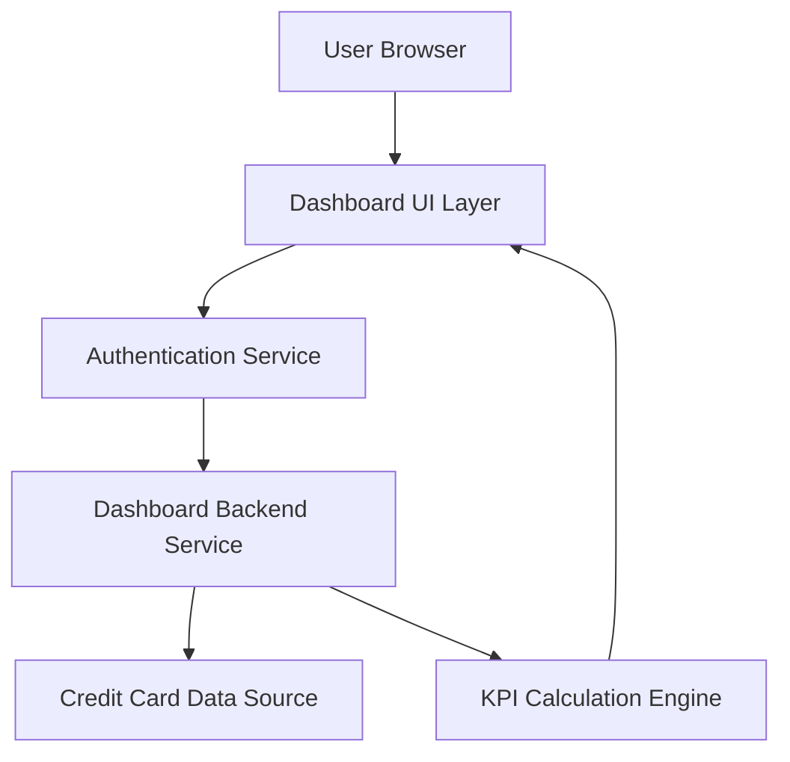

#### 1. High-Level Design

- **Summary:** This epic delivers a centralized credit card dashboard that displays key performance indicators (Monthly Spend, Total Credit Limit, Available Credit, Outstanding Amount) in real-time. The dashboard provides users with a unified view of their credit card portfolio health, enabling at-a-glance monitoring of credit utilization and spending patterns across all cards.

- **Component Flow:**

- **Integration Points:**
  - **Upstream:** User authentication service for secure access control
  - **Downstream:** Credit card data source or mock data service for retrieving card balances, limits, and transaction data
  - **Internal:** KPI calculation engine for computing Monthly Spend, Available Credit, and Outstanding Amount metrics

- **Key Assumptions:**
  - Data refresh mechanism will use polling or push notifications from the data source; assuming real-time means refresh intervals of 30-60 seconds.
  - Credit card data is assumed to be pre-aggregated or available via API calls with response times under 500ms to meet the 2-second load requirement.

- **NFR Highlights:** Dashboard must load within 2 seconds; must support responsive design for mobile and desktop; data accuracy at 99.9%; must handle concurrent users viewing individual dashboards.

#### 2. Validation Report

- **Requirements Coverage:** The design fully covers the epic's stated scope including all four KPI displays (Monthly Spend, Total Credit Limit, Available Credit, Outstanding Amount), consolidated dashboard view, and real-time data refresh. The component architecture addresses authentication, data retrieval, KPI computation, and responsive UI rendering. All specified NFRs (2-second load time, responsive design, 99.9% accuracy, concurrent user support) are accounted for in the design. Integration dependencies with authentication service and credit card data source are explicitly mapped.