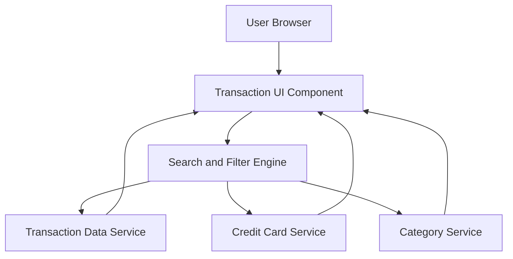

### 1. High-Level Design

**Summary:**  
This epic provides comprehensive transaction management capabilities enabling users to view, search, filter, and analyze all credit card transactions across their portfolio from a unified interface. The solution displays detailed transaction information (date, merchant, amount, category, card) and supports advanced filtering, search, and date range selection to help users track spending behavior and detect anomalies.

**Component Flow:**

**Integration Points:**
- **Upstream:** Transaction Data Service (for retrieving transaction records)
- **Upstream:** Credit Card Service (for card-transaction mapping)
- **Upstream:** Category Service (for transaction classification logic)

**Key Assumptions:**
- Transaction data is stored in a scalable database with indexed fields (date, card ID, category) for fast query performance.
- Pagination is implemented server-side with default page size of 50 transactions to optimize load times.

**NFR Highlights:**  
Search/filter operations ≤1 second, pagination support for large datasets, handle minimum 10,000 transactions per user, chronological display with sorting.

### 2. Validation Report

**Requirements Coverage:**  
The design comprehensively covers all scope items including transaction list view, detail display, multi-card aggregation, search and filter functionality, categorization, date range selection, card-wise filtering, and responsive interface. The architecture addresses all NFRs through pagination (handling large datasets), indexed search engine (1-second response), scalable data service (10,000+ transactions), and sorting capabilities built into the UI component.