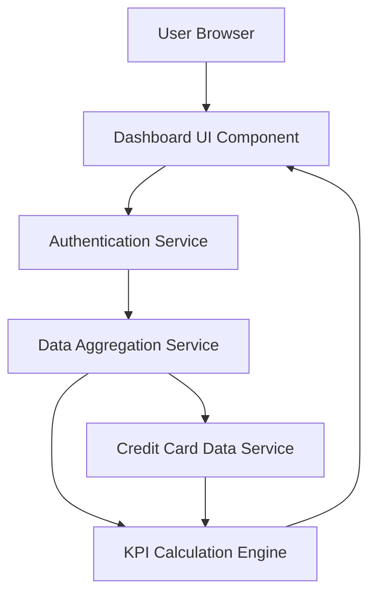

### 1. High-Level Design

**Summary:**  
This epic delivers a centralized dashboard that provides users with a consolidated view of their entire credit card portfolio. The dashboard displays key performance indicators (KPIs) including monthly spending patterns, total credit limits, available credit, and outstanding amounts across multiple credit cards. The solution enables real-time monitoring of credit card health and financial position through an intuitive, responsive interface.

**Component Flow:**

**Integration Points:**
- **Upstream:** User Authentication Service (for secure access control)
- **Upstream:** Credit Card Data Service (for retrieving card information)
- **Internal:** Data Aggregation Service (for KPI calculations and consolidation)

**Key Assumptions:**
- Credit card data is available via RESTful API with JSON format and updates in near real-time (within 5 minutes).
- User session management and token-based authentication are handled by existing enterprise authentication infrastructure.

**NFR Highlights:**  
Dashboard load time ≤2 seconds, real-time data refresh support, responsive across desktop/tablet/mobile, support up to 50 cards per user.

### 2. Validation Report

**Requirements Coverage:**  
The design fully addresses the epic's stated scope including dashboard interface development, multi-card display, monthly spend calculation, credit limit aggregation, available credit computation, outstanding amount tracking, KPI visualization, and responsive layout. All specified NFRs (2-second load time, real-time refresh, multi-device responsiveness, 50-card capacity) are incorporated into the architecture through the data aggregation service and optimized UI components.