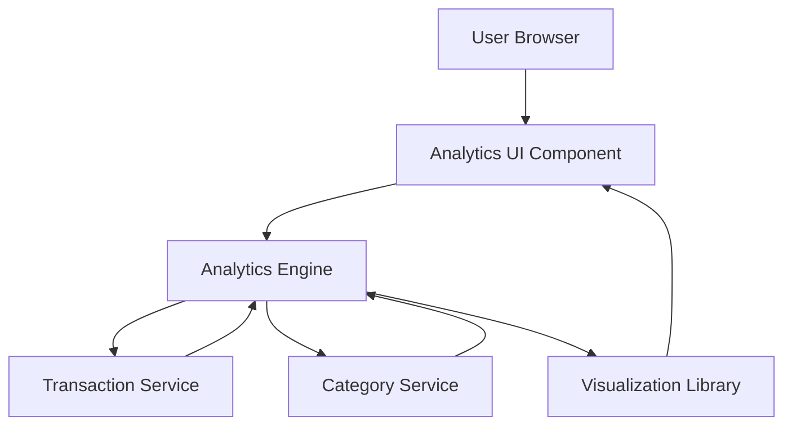

### 1. High-Level Design

**Summary:**  
This epic delivers advanced analytics and visualization capabilities that transform transaction data into actionable financial insights. Users can explore interactive visualizations including monthly spend trends, category-wise spending analysis (across 9 predefined categories), and card-wise spending breakdowns. The solution employs charts, graphs, and visual representations to make complex spending patterns easily understandable and support data-driven financial decisions.

**Component Flow:**

**Integration Points:**
- **Upstream:** Transaction Service (for raw spending data)
- **Upstream:** Category Service (for classification logic across 9 categories)
- **Internal:** Analytics Engine (for data processing, aggregation, and trend analysis)
- **External:** Visualization Library (for chart rendering - likely D3.js, Chart.js, or similar)

**Key Assumptions:**
- Historical transaction data is retained for at least 24 months and is accessible with acceptable query performance.
- Category classification is pre-computed and stored with transactions rather than calculated on-demand during analytics rendering.

**NFR Highlights:**  
Visualizations render within 3 seconds, interactive charts with drill-down support, handle 24+ months historical data, responsive visualizations across screen sizes.

### 2. Validation Report

**Requirements Coverage:**  
The design fully addresses the epic's scope including category-wise visualization, monthly trend analysis, card-wise spend comparison, interactive charts/graphs, spending pattern identification, multi-dimensional filtering, predefined category breakdown, time-series analysis, and responsive analytics interface. All NFRs are accommodated through the analytics engine (3-second rendering, 24-month data handling), visualization library (interactivity and drill-down), and responsive UI components (adaptive screen sizing).