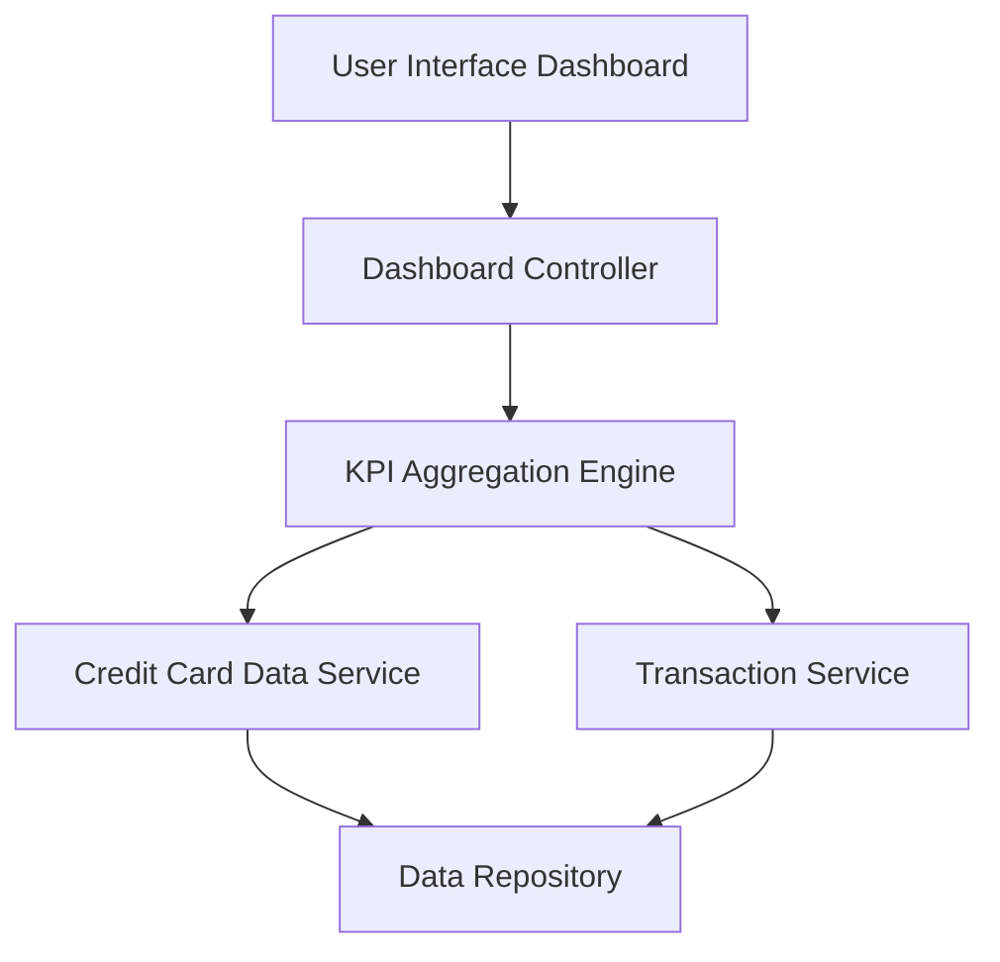

#### 1. High-Level Design

- **Summary:** This epic delivers a consolidated dashboard that displays key performance indicators (KPIs) for the user's credit card portfolio, including monthly spend, total credit limit, available credit, and outstanding amounts. The dashboard provides a responsive, at-a-glance view of overall financial health across all credit cards, enabling informed spending decisions.

- **Component Flow:**

- **Integration Points:**
  - **Upstream:** Credit Card Data Service (retrieves card balances and limits), Transaction Service (calculates monthly spend and outstanding amounts)
  - **Downstream:** User Interface Dashboard (displays consolidated KPIs)

- **Key Assumptions:**
  - KPI data is refreshed in near real-time or at regular intervals (e.g., every 5 minutes) from backend services.
  - All credit card data is pre-aggregated and available via REST APIs from the credit card data service and transaction service.

- **NFR Highlights:** Dashboard must load within 2 seconds, support responsive design for mobile and desktop devices, handle real-time data refresh for KPI updates.

#### 2. Validation Report

- **Requirements Coverage:** The design fully covers the epic's stated scope by including monthly spend display, total credit limit calculation, available credit tracking, outstanding amount display, responsive dashboard layout, and consolidated KPI view. The component flow integrates the necessary upstream services (Credit Card Data Service and Transaction Service) to aggregate and display KPIs. The NFRs for load time (2 seconds), responsive design, and real-time refresh are addressed through the KPI Aggregation Engine and responsive UI components.