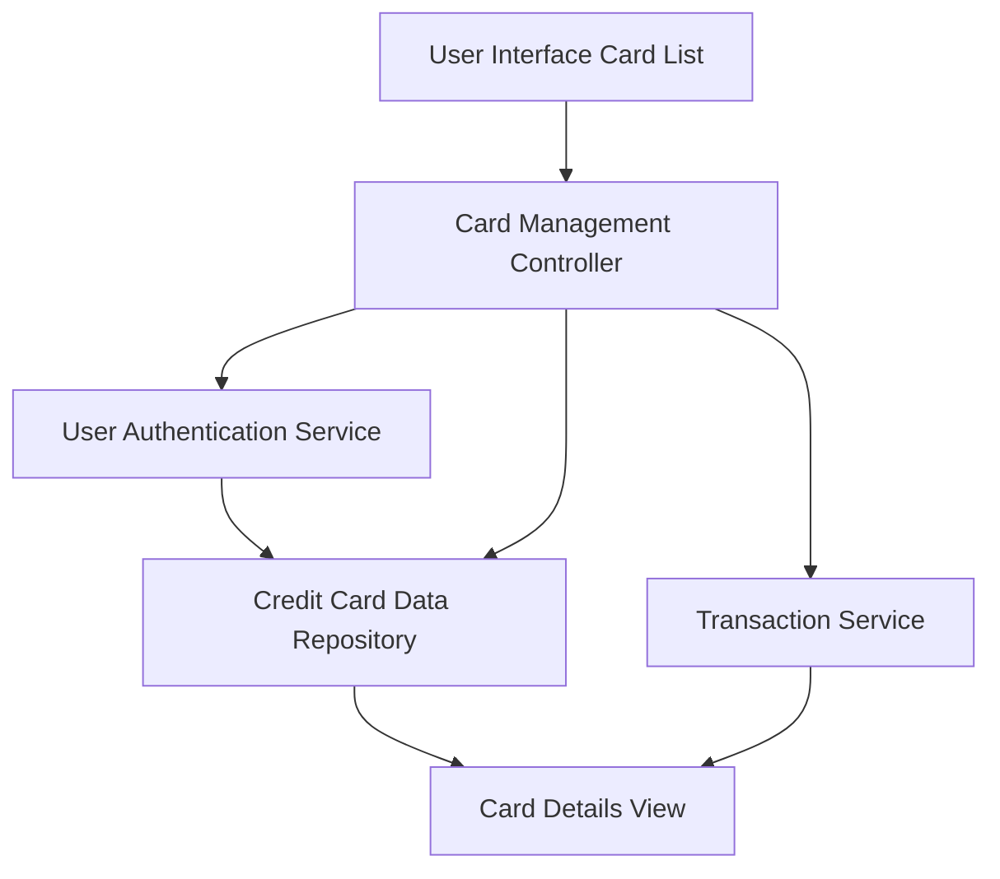

#### 1. High-Level Design

- **Summary:** This epic enables users to manage and view multiple credit cards within a unified interface. Users can see all their credit cards in one place, access card-specific details, and perform card-wise spend analysis. The feature provides a comprehensive view of each card's individual performance, limits, and usage patterns, facilitating comparison and management of multiple credit accounts.

- **Component Flow:**

- **Integration Points:**
  - **Upstream:** Credit Card Data Repository (provides card information), User Authentication Service (validates card ownership), Transaction Service (provides card-specific spending data)
  - **Downstream:** User Interface Card List and Card Details View (displays multiple cards and individual card metrics)

- **Key Assumptions:**
  - Card ownership validation is performed via token-based authentication with the User Authentication Service.
  - Card-specific spending data is retrieved on-demand or cached for performance when a user selects a specific card.

- **NFR Highlights:** System must support display of at least 20 credit cards per user, card data retrieval must complete within 1 second, interface must maintain performance with multiple cards loaded.

#### 2. Validation Report

- **Requirements Coverage:** The design addresses the epic's scope by supporting multiple credit card display, card-wise spend analysis, individual card details view, card selection and filtering, and card-specific metrics display. The component flow integrates the User Authentication Service for ownership validation, Credit Card Data Repository for card information, and Transaction Service for spending data. The NFRs for supporting at least 20 cards, 1-second retrieval time, and performance maintenance are addressed through efficient data retrieval and caching strategies in the Card Management Controller.