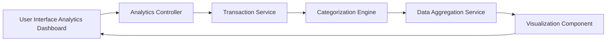

#### 1. High-Level Design

- **Summary:** This epic provides users with interactive visualizations and analytics capabilities to understand spending patterns across different categories (Food & Dining, Fuel, Shopping, Travel, Entertainment, Utilities, Healthcare, Education, Miscellaneous). The feature includes monthly spend trend analysis, enabling users to identify spending patterns over time and make data-driven financial decisions.

- **Component Flow:**

- **Integration Points:**
  - **Upstream:** Transaction Service (provides raw transaction data), Categorization Engine (classifies transactions into predefined categories), Data Aggregation Service (computes trends and summaries)
  - **Downstream:** User Interface Analytics Dashboard and Visualization Component (renders interactive charts and graphs)

- **Key Assumptions:**
  - Transactions are automatically categorized by the Categorization Engine using predefined rules or machine learning models.
  - Analytics data is aggregated and stored for up to 12 months, with monthly granularity for trend analysis.

- **NFR Highlights:** Analytics visualizations must render within 3 seconds, support interactive filtering and drill-down capabilities, handle transaction data for up to 12 months of history.

#### 2. Validation Report

- **Requirements Coverage:** The design comprehensively covers the epic's scope by including category-wise spending visualization, monthly spend trends, interactive charts and graphs, spending pattern analysis, multi-category breakdown, and transaction categorization display. The component flow integrates the Transaction Service for raw data, Categorization Engine for classification, and Data Aggregation Service for trend computation. The NFRs for 3-second rendering, interactive filtering, and 12-month data handling are addressed through the Analytics Controller and Visualization Component, which support efficient data processing and interactive UI elements.