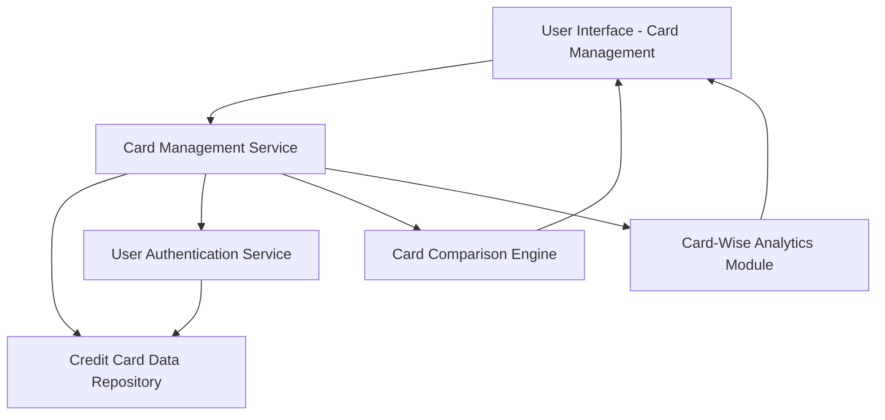

#### 1. High-Level Design

- **Summary:** This epic enables users to manage and monitor multiple credit cards within a unified interface. Users can view individual card details, compare card-specific metrics, perform card-wise spending analysis, and seamlessly navigate between cards. The solution consolidates all credit card information for users maintaining multiple cards, providing comprehensive visibility into each card's credit limit, available balance, and outstanding amounts.

- **Component Flow:**

- **Integration Points:**
  - **Upstream:** Credit Card Data Repository (stores and retrieves multiple card information per user)
  - **Upstream:** User Authentication Service (associates cards with authenticated user accounts)

- **Key Assumptions:**
  - Card data is stored in a normalized structure allowing efficient retrieval of unlimited cards per user with pagination or lazy loading for large card portfolios.
  - Card comparison and card-wise analytics leverage pre-computed metrics stored alongside card data to meet the 2-second retrieval requirement.

- **NFR Highlights:** System must support unlimited credit cards per user; card data retrieval must complete within 2 seconds; interface must maintain usability with 10+ cards displayed.

- **Data Flow:** User logs in → User Authentication Service validates identity and retrieves associated card IDs → Card Management Service queries Credit Card Data Repository for all user cards → UI displays card list with summary metrics → User selects specific card for detailed view → Card-Wise Analytics Module retrieves transaction history for selected card → User compares cards via Card Comparison Engine → Results displayed side-by-side in responsive interface.

#### 2. Validation Report

- **Requirements Coverage:** The design fully addresses the epic scope including multiple credit card display, individual card detail views, card-wise spend analysis, card comparison capabilities, and card selection/navigation. The architecture meets all NFRs: unlimited card support (via scalable data repository with pagination), 2-second retrieval (through optimized queries and indexing), and usability with 10+ cards (via responsive UI with filtering/sorting). All dependencies are satisfied through integration with Credit Card Data Repository and User Authentication Service. The design supports seamless multi-card management and eliminates the need for multiple banking app access.