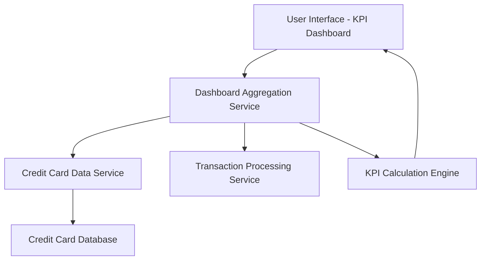

#### 1. High-Level Design

- **Summary:** This epic implements a consolidated dashboard that displays key performance indicators (KPIs) for all user credit cards in a single responsive view. The dashboard aggregates and displays monthly spend totals, total credit limits, available credit, and outstanding amounts across multiple cards, providing users with a real-time financial health snapshot.

- **Component Flow:**

- **Integration Points:**
  - **Upstream:** Credit Card Data Service (retrieves card balances, limits, and outstanding amounts)
  - **Upstream:** Transaction Processing Service (provides monthly spend calculations)

- **Key Assumptions:**
  - KPI calculations are performed server-side with results cached for performance; real-time refresh means updates occur within seconds when underlying data changes.
  - Multi-card aggregation assumes all cards belong to the authenticated user and are retrieved in a single query or batch operation.

- **NFR Highlights:** Dashboard must be responsive across desktop, tablet, and mobile devices; KPI calculations must refresh in real-time; system must support concurrent viewing of multiple credit cards without performance degradation.

- **Data Flow:** User accesses dashboard → Dashboard Aggregation Service retrieves credit card details from Credit Card Data Service → Transaction Processing Service provides current month spend data → KPI Calculation Engine aggregates totals across all cards (total credit limit, available credit, outstanding amounts, monthly spend) → Responsive UI renders KPIs with real-time updates → User views consolidated financial health metrics.

#### 2. Validation Report

- **Requirements Coverage:** The design comprehensively addresses all scope elements including monthly spend display, total credit limit aggregation, available credit calculation, outstanding amount tracking, responsive dashboard layout, and multi-card consolidated view. The architecture satisfies NFRs through responsive UI framework (desktop/tablet/mobile support), real-time KPI calculation engine (sub-second refresh), and optimized data retrieval for multiple cards (no performance degradation). All stated dependencies are covered via integration with Credit Card Data Service and Transaction Processing Service.