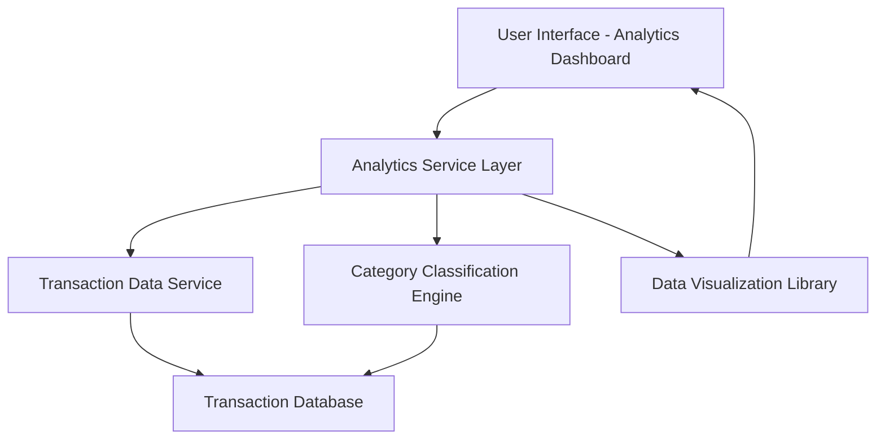

#### 1. High-Level Design

- **Summary:** This epic delivers an interactive analytics module that enables users to visualize and analyze their credit card spending patterns across multiple predefined categories (Food & Dining, Fuel, Shopping, Travel, Entertainment, Utilities, Healthcare, Education, Miscellaneous) over time. The solution provides trend analysis, category-wise breakdowns, and actionable insights to support informed financial decision-making.

- **Component Flow:**

- **Integration Points:**
  - **Upstream:** Transaction Data Service (provides categorized transaction history)
  - **Upstream:** Category Classification Engine (categorizes transactions into predefined categories)
  - **External:** Data Visualization Library (third-party or internal library for rendering interactive charts)

- **Key Assumptions:**
  - Transactions are pre-categorized by the Category Classification Engine before being stored; the analytics module does not perform real-time categorization.
  - Historical data is retained for at least 12 months in the transaction database with appropriate indexing for performance.

- **NFR Highlights:** Analytics visualizations must load within 3 seconds; system must support 12+ months of historical data analysis; interactive charts must be responsive with drill-down capabilities.

- **Data Flow:** User requests analytics view → Analytics Service Layer queries Transaction Data Service for historical transactions → Category Classification Engine provides category mappings → Analytics Service aggregates data by category and time period → Data Visualization Library renders interactive charts → User interacts with visualizations to drill down into specific categories or time periods.

#### 2. Validation Report

- **Requirements Coverage:** The design fully covers the epic's stated scope including category-wise spending analysis, monthly trend visualization, interactive charts, and multi-category breakdown across all 9 specified categories. The architecture supports the NFR requirements for 3-second load time (through optimized queries and caching), 12-month historical data analysis (via Transaction Database), and interactive drill-down capabilities (via Data Visualization Library). All dependencies are addressed through clear integration points with Transaction Data Service, Category Classification Engine, and Data Visualization Library.