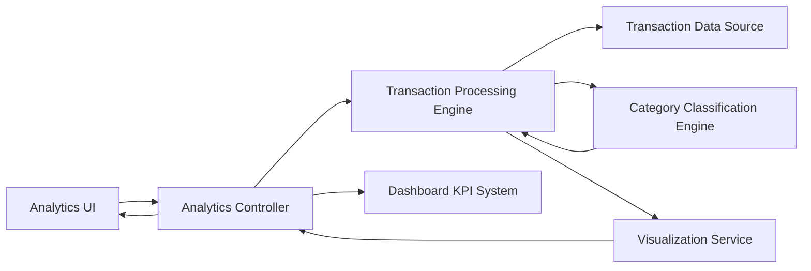

#### 1. High-Level Design

- **Summary**: This epic provides advanced analytics and visualization capabilities to help users understand spending patterns through interactive charts, monthly trend analysis, and category-based spending insights across nine predefined categories (Food & Dining, Fuel, Shopping, Travel, Entertainment, Utilities, Healthcare, Education, Miscellaneous). The system processes transaction data to generate actionable financial insights.

- **Component Flow**:

- **Integration Points**: 
  - Upstream: Transaction data source for raw transaction records
  - Upstream: Category classification engine for categorizing transactions into nine predefined categories
  - Upstream: Dashboard KPI system for monthly spend data consistency
  - Downstream: Visualization library for rendering charts and graphs

- **Key Assumptions**: 
  - Transaction data includes sufficient metadata for accurate category classification (merchant info, transaction codes)
  - Historical data retention period for trend analysis is defined by system policy (not specified in epic)

- **NFR Highlights**: Analytics visualizations must render within 3 seconds; system must process and categorize transactions accurately; support interactive filtering and drill-down capabilities; handle historical data for trend analysis

- **Data Flow**: User accesses analytics interface → Analytics Controller requests transaction data from Transaction Data Source → Transaction Processing Engine retrieves and processes transactions → Category Classification Engine categorizes each transaction into one of nine categories → Processed data aggregated by month and category → Visualization Service generates interactive charts (monthly trends, category-wise breakdown) → Controller retrieves monthly spend from Dashboard KPI System for validation → UI renders visualizations with interactive filtering and drill-down capabilities

#### 2. Validation Report

- **Requirements Coverage**: The design comprehensively covers all scope elements including monthly spend trend visualization, category-wise spending analysis across nine categories, interactive charts, transaction data processing, spending classification, pattern identification, and time-based trend analysis. All NFRs are addressed: 3-second rendering through dedicated Visualization Service, accurate categorization via Classification Engine, interactive filtering/drill-down in UI layer, and historical data handling in Transaction Processing Engine. Integration with Dashboard KPI system ensures data consistency across the platform.