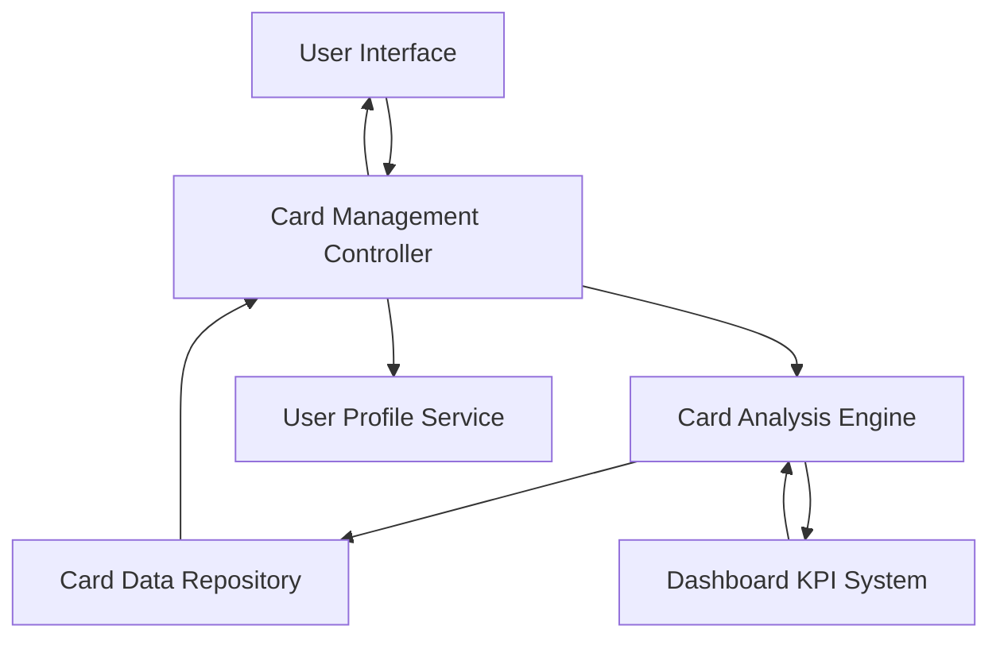

#### 1. High-Level Design

- **Summary**: This epic enables comprehensive multi-card management capabilities, allowing users to view, organize, and monitor up to 10+ credit cards with detailed card-specific information including spending, limits, and balances. The system supports card-wise spend analysis and comparison functionality to optimize credit card portfolio usage.

- **Component Flow**:

- **Integration Points**: 
  - Upstream: Credit card data repository for card details and transaction history
  - Upstream: User profile service for user-specific card associations
  - Lateral: Dashboard KPI system for aggregated metrics and consolidated views

- **Key Assumptions**: 
  - Card data includes sufficient detail for spend analysis (transaction history, categorization)
  - Card organization/sorting preferences are stored per user profile (criteria not specified: by spend, limit, name, etc.)

- **NFR Highlights**: System must support at least 10 credit cards per user; card data retrieval must complete within 1 second; secure storage and display of card information

- **Data Flow**: User accesses card management interface → Card Management Controller retrieves user's card list from User Profile Service → Card Analysis Engine fetches detailed card data from Card Data Repository → Engine calculates card-wise spend analysis and retrieves aggregated metrics from Dashboard KPI System → Controller organizes and sorts cards based on user preferences → UI displays individual card details, balances, and comparative analysis

#### 2. Validation Report

- **Requirements Coverage**: The design addresses all scope elements including multiple card display, card-wise spend analysis, individual card details, balance tracking, comparison functionality, and organization/sorting. NFRs are covered through dedicated Card Analysis Engine (1-second retrieval), secure data repository, and support for 10+ cards per user. Integration with Dashboard KPI system ensures consistency with aggregated metrics.