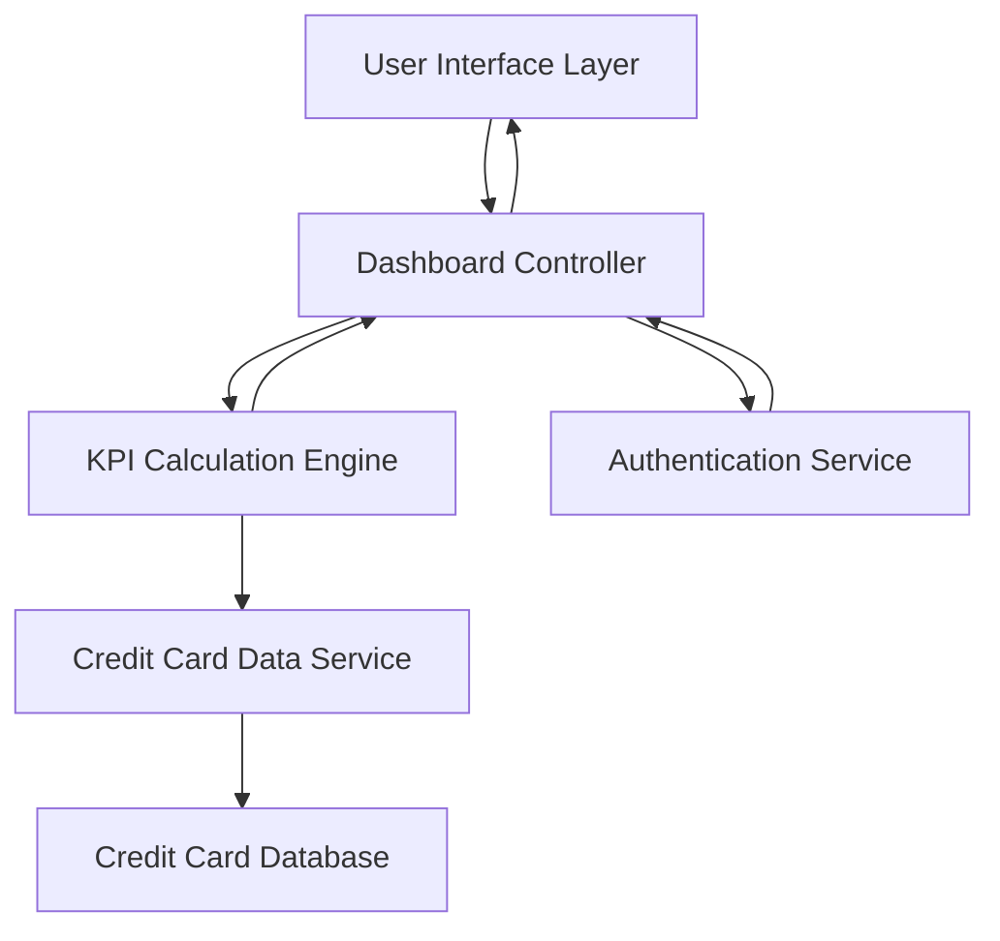

#### 1. High-Level Design

- **Summary**: This epic delivers a responsive dashboard that consolidates credit card data across multiple cards, displaying key performance indicators including monthly spend, total credit limit, available credit, and outstanding amounts. The system provides real-time visibility into overall credit health through an intuitive, device-agnostic interface.

- **Component Flow**:

- **Integration Points**: 
  - Upstream: Credit card data source/database for retrieving card information and transaction data
  - Upstream: User authentication service for secure access control
  - Downstream: Responsive UI framework for multi-device rendering

- **Key Assumptions**: 
  - Credit card data is available in a structured format with standardized fields (limit, balance, outstanding amount)
  - Real-time data refresh implies periodic polling or event-driven updates from the data source (frequency not specified)

- **NFR Highlights**: Dashboard must load within 2 seconds; support responsive design across desktop, tablet, and mobile devices; handle real-time data refresh for KPI metrics

- **Data Flow**: User authenticates → Dashboard Controller requests user's credit card data → Credit Card Data Service retrieves data from database → KPI Calculation Engine aggregates metrics (monthly spend, total limit, available credit, outstanding amounts) → Processed KPIs returned to Dashboard Controller → UI Layer renders consolidated view with real-time updates

#### 2. Validation Report

- **Requirements Coverage**: The design fully covers the epic's stated scope including dashboard interface, KPI calculations (monthly spend, credit limits, available credit, outstanding amounts), multi-card consolidated view, and responsive layout. All NFRs (2-second load time, responsive design, real-time refresh) are addressed through appropriate architectural components (calculation engine, responsive UI layer, data service).