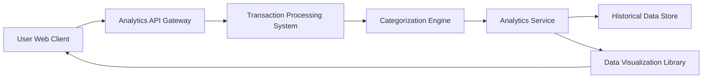

#### 1. High-Level Design

- **Summary:** This epic provides interactive analytics and visualization capabilities that enable users to understand spending patterns through category-wise analysis. Transactions are automatically categorized into 9 predefined categories (Food & Dining, Fuel, Shopping, Travel, Entertainment, Utilities, Healthcare, Education, Miscellaneous), with visual representations showing spending distribution, trends, and drill-down capabilities for detailed analysis.

- **Component Flow:**

- **Integration Points:** 
  - **Upstream:** Transaction processing system (provides raw transaction data), Categorization engine (applies ML/rule-based logic to assign categories), Analytics service (aggregates and processes categorized data), Data visualization library (renders charts and graphs)
  - **Downstream:** User Web Client displays interactive visualizations and category drill-downs

- **Key Assumptions:** 
  - Categorization engine uses a combination of merchant codes and transaction descriptions to achieve 95% accuracy
  - Historical data retention is minimum 12 months with monthly archival for older data

- **NFR Highlights:** Analytics engine must process and categorize transactions with 95% accuracy, visualizations must render within 1 second, support historical data analysis for minimum 12 months, ensure scalability for high transaction volumes

- **Data Flow:** User requests transaction analytics view → Analytics API Gateway retrieves transactions from Transaction Processing System → Transactions are passed to Categorization Engine which assigns categories based on merchant data and transaction attributes → Categorized transactions are sent to Analytics Service → Analytics Service aggregates spending by category, calculates distributions and trends, and retrieves historical data from Historical Data Store (up to 12 months) → Processed analytics data is passed to Data Visualization Library → Library generates interactive charts and graphs (pie charts, bar graphs, trend lines) → Visualizations are rendered in User Web Client within 1 second → User can drill down into specific categories to view detailed transaction lists and time-period analysis

#### 2. Validation Report

- **Requirements Coverage:** The design fully addresses all scope requirements including category-wise spending visualization across 9 predefined categories, transaction categorization, interactive charts and graphs, spending pattern analysis, transaction history view, and category drill-down capability. The Categorization Engine architecture supports the 95% accuracy NFR through intelligent categorization logic. The 1-second visualization rendering requirement is achievable through the optimized Analytics Service and Data Visualization Library integration. Historical data analysis for minimum 12 months is supported via the Historical Data Store component. Scalability for high transaction volumes is ensured through the separation of concerns between transaction processing, categorization, and analytics services. All dependencies (transaction processing system, categorization engine, analytics service, data visualization library) are explicitly integrated in the component flow.