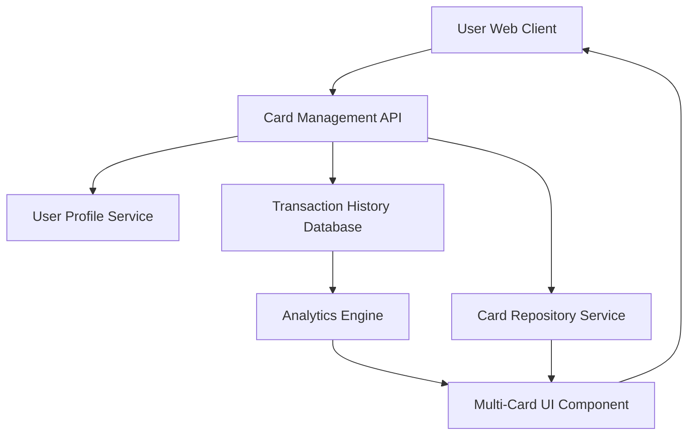

#### 1. High-Level Design

- **Summary:** This epic enables users to view and manage multiple credit cards within a unified interface. Users can view all their cards, switch between them to see card-specific details, analyze spending patterns at both portfolio and individual card levels, and visualize monthly spend trends with comparative analytics across cards.

- **Component Flow:**

- **Integration Points:** 
  - **Upstream:** Credit card data repository (stores card details and metadata), User profile service (manages user-card associations), Transaction history database (provides transaction data for spend analysis)
  - **Downstream:** Multi-Card UI Component renders card list, card details, and comparative analytics

- **Key Assumptions:** 
  - Card switching is client-side operation with data pre-fetched or cached for sub-200ms response time
  - Monthly spend trends are calculated on a rolling 12-month basis unless otherwise specified

- **NFR Highlights:** System must support minimum 10 credit cards per user, card switching must be instantaneous with sub-200ms response time, ensure data isolation and security for each card's information

- **Data Flow:** User requests multi-card view → Card Management API authenticates and retrieves user's card list from Card Repository Service via User Profile Service → API fetches transaction history from Transaction History Database for each card → Analytics Engine processes data to generate card-wise spend analysis and monthly trends → Multi-Card UI Component receives card details and analytics → UI renders card list with switching capability and comparative visualizations → User selects a card → UI instantly switches view to display card-specific information and spending patterns

#### 2. Validation Report

- **Requirements Coverage:** The design comprehensively addresses all scope elements including multiple credit card display, card selection and switching, card-wise spend analysis, monthly spend trends visualization, card details view, and comparative card analytics. The architecture supports the NFR requirement of minimum 10 cards per user through the Card Repository Service, and the sub-200ms card switching requirement is achievable through client-side rendering with pre-fetched data. Data isolation and security are enforced at the Card Management API and Card Repository Service layers. All dependencies (card repository, user profile service, transaction history database) are integrated into the component flow.