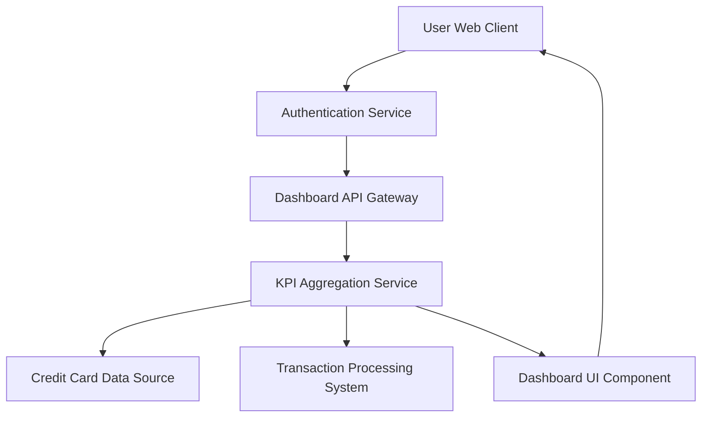

#### 1. High-Level Design

- **Summary:** This epic delivers a centralized financial dashboard that provides users with real-time visibility into their credit card portfolio through key performance indicators. The dashboard displays monthly spending, total credit limit across all cards, available credit, and outstanding amounts, enabling users to monitor their financial health and credit utilization at a glance.

- **Component Flow:**

- **Integration Points:** 
  - **Upstream:** Credit card data source system (provides card details, limits, balances), Transaction processing system (provides transaction data for monthly spend calculation), User authentication service (validates user identity and session)
  - **Downstream:** Dashboard UI renders aggregated KPIs to the user

- **Key Assumptions:** 
  - Data refresh frequency is assumed to be near real-time (within 5-10 seconds of transaction posting)
  - Financial calculations (available credit, outstanding amounts) follow standard credit card accounting rules

- **NFR Highlights:** Dashboard must load within 2 seconds, support real-time data refresh, ensure responsive design across desktop and mobile devices, maintain data accuracy for all financial calculations

- **Data Flow:** User authenticates and requests dashboard view → Authentication service validates user → Dashboard API Gateway routes request to KPI Aggregation Service → Aggregation Service fetches card details from Credit Card Data Source and transaction data from Transaction Processing System → Service calculates monthly spend, total credit limit, available credit, and outstanding amounts → Aggregated KPIs are returned to Dashboard UI Component → UI renders responsive dashboard with financial overview to user

#### 2. Validation Report

- **Requirements Coverage:** The design fully covers the epic's stated scope including monthly spend display, total credit limit calculation, available credit computation, outstanding amount tracking, consolidated multi-card view, and responsive dashboard layout. All NFRs (2-second load time, real-time refresh, responsive design, data accuracy) are addressed through the KPI Aggregation Service architecture and UI component design. The integration with required dependencies (credit card data source, transaction processing, authentication) is explicitly mapped in the component flow.