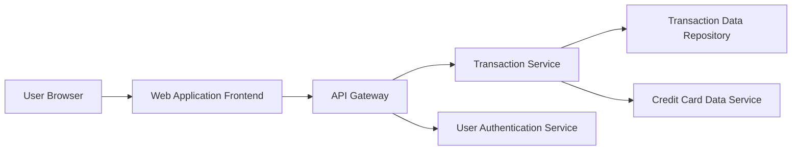

### 1. High-Level Design

**Summary:**  
This epic enables users to view and access credit card transactions across all their cards through a transaction listing interface with detail views. It provides the foundational capability for tracking financial activities, verifying charges, and monitoring spending behavior with support for large transaction datasets and multi-card aggregation.

**Component Flow:**

**Integration Points:**
- **Upstream:** Transaction data repository/database containing transaction records
- **Upstream:** Credit card data service for linking transactions to specific cards
- **Upstream:** User authentication and authorization service
- **Downstream:** Responsive transaction interface (web/mobile)

**Key Assumptions:**
- Transaction data includes standard fields (transaction_id, card_id, amount, merchant, date, category) accessible via REST API.
- Transaction history is retained for a minimum of 12-24 months and pagination is used for large datasets.

**NFR Highlights:**  
System must efficiently handle and display large transaction datasets; transaction data presented with appropriate security measures; interface responsive across all device types.

### 2. Validation Report

**Requirements Coverage:**  
The design addresses all scope elements: transaction listing view, transaction details display, multi-card transaction aggregation, transaction history access, and responsive interface. The architecture supports efficient handling of large datasets through dedicated Transaction Service with pagination capabilities. Security measures are addressed through the User Authentication Service integration. All NFRs related to dataset handling, security, and responsiveness are covered in the component design.