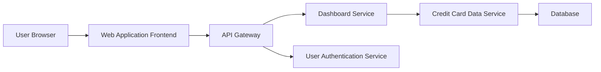

### 1. High-Level Design

**Summary:**  
This epic delivers a consolidated dashboard that displays key performance indicators (KPIs) for all user credit cards, including monthly spend, total credit limit, available credit, and outstanding amounts. The dashboard provides a single-pane view of the user's credit card portfolio with real-time or near-real-time data refresh capabilities across responsive layouts.

**Component Flow:**

**Integration Points:**
- **Upstream:** Credit card data source/database containing card details and transaction information
- **Upstream:** User authentication service for secure access to personal financial data
- **Downstream:** Web/mobile frontend applications (responsive UI)

**Key Assumptions:**
- Credit card data is available via API in JSON format with standard fields (card_id, limit, balance, monthly_spend, outstanding_amount).
- Data refresh occurs at intervals of 5-15 minutes (near-real-time) rather than true real-time streaming.

**NFR Highlights:**  
Dashboard must be responsive across desktop, tablet, and mobile devices; page load time optimized for quick access; supports real-time or near-real-time data refresh.

### 2. Validation Report

**Requirements Coverage:**  
The design covers all stated scope items: KPI displays for monthly spend, total credit limit, available credit, outstanding amount, multiple credit card view, consolidated interface, and responsive layout. The component flow addresses the need for secure authentication, data retrieval from credit card data sources, and responsive frontend delivery. All NFRs (responsiveness, load time optimization, data refresh) are architecturally supported through the API Gateway pattern and dedicated Dashboard Service.