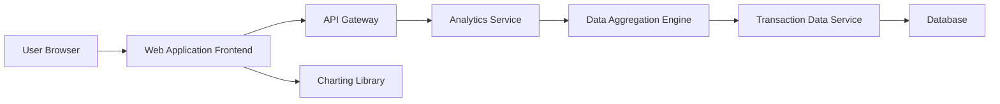

### 1. High-Level Design

**Summary:**  
This epic delivers interactive visualizations and analytical capabilities for understanding spending patterns through monthly spend trends, card-wise spend analysis, and category-wise spending breakdowns across nine predefined categories (Food & Dining, Fuel, Shopping, Travel, Entertainment, Utilities, Healthcare, Education, Miscellaneous). The module provides actionable insights through visual representations with performant calculations and interactive charts.

**Component Flow:**

**Integration Points:**
- **Upstream:** Transaction data service for raw spending data
- **Upstream:** Data aggregation and analytics engine for processing category-wise spending
- **Upstream:** Charting or visualization library for interactive displays
- **Downstream:** Responsive analytics interface with interactive visualizations

**Key Assumptions:**
- Transactions are pre-categorized or a categorization engine assigns one of the nine categories based on merchant/MCC codes.
- Monthly aggregations are pre-computed or cached to ensure performant loading of trend visualizations.

**NFR Highlights:**  
Visualizations must load efficiently even with large datasets; charts must be interactive and responsive across all device types; analytics calculations must be accurate and performant.

### 2. Validation Report

**Requirements Coverage:**  
The design comprehensively covers all scope items: monthly spend trend visualization, card-wise spend analysis, category-wise spending breakdown for all nine categories, interactive charts, spending pattern identification, and responsive analytics interface. The architecture incorporates a dedicated Analytics Service and Data Aggregation Engine to ensure performant calculations. Integration with charting libraries supports interactive visualizations. All NFRs (efficient loading, interactivity, responsiveness, accuracy, performance) are addressed through the layered architecture with dedicated aggregation and caching capabilities.