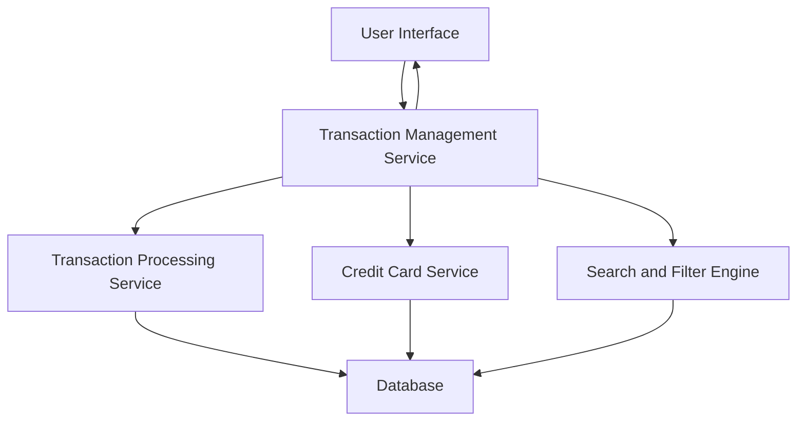

#### 1. High-Level Design

- **Summary**: This epic provides comprehensive transaction management capabilities allowing users to view, monitor, and track all credit card transactions across their multiple cards. Users can access detailed transaction histories, view transaction details, and monitor spending activity in real-time with support for filtering, searching, and organizing transactions.

- **Component Flow**:

- **Integration Points**: 
  - **Upstream**: Transaction Processing Service (for transaction data retrieval and real-time transaction monitoring)
  - **Upstream**: Credit Card Service (for mapping transactions to specific cards and card details)
  - **Internal**: Search and Filter Engine (for transaction filtering and search operations)

- **Key Assumptions**: 
  - Transactions are stored with timestamps, card identifiers, and sufficient metadata to support filtering and searching.
  - Pagination is implemented to handle large transaction datasets efficiently (up to 10,000 transactions per user).

- **NFR Highlights**: Transaction list must support pagination for large datasets; Search and filter operations must complete within 500ms; System must handle up to 10,000 transactions per user efficiently.

- **Data Flow**: User accesses transaction interface → Transaction Management Service retrieves transaction data from Transaction Processing Service → Credit Card Service maps transactions to specific cards → Search and Filter Engine applies user-specified filters/search criteria → Transaction Management Service paginates results → User Interface displays transaction list with details → User can drill down into individual transaction details, apply filters, or search across transaction history.

#### 2. Validation Report

- **Requirements Coverage**: The design comprehensively covers all requirements including transaction listing and display, transaction detail view, multi-card transaction support, transaction filtering and search, transaction history tracking, and responsive transaction interface. The architecture supports all NFRs: pagination for large datasets, 500ms search/filter performance, and efficient handling of up to 10,000 transactions per user. Integration points with Transaction Processing Service and Credit Card Service are clearly defined to enable complete transaction visibility and control.