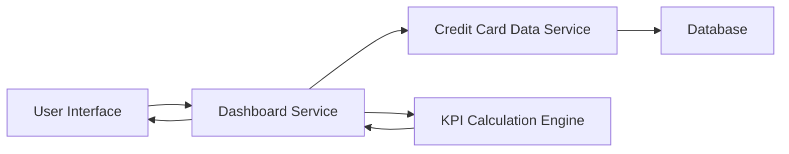

#### 1. High-Level Design

- **Summary**: This epic enables users to view a consolidated dashboard displaying key performance indicators for all their credit cards in a single interface. Users can monitor critical financial metrics including monthly spend, total credit limit, available credit, and outstanding amounts across multiple credit cards through a modern, responsive interface.

- **Component Flow**:

- **Integration Points**: 
  - **Upstream**: Credit Card Data Service (for retrieving card details, balances, credit limits, and outstanding amounts)
  - **Internal**: KPI Calculation Engine (for real-time calculation of available credit and aggregation of metrics)

- **Key Assumptions**: 
  - Credit Card Data Service provides real-time or near-real-time data for accurate balance and limit information.
  - Available credit is calculated as (Total Credit Limit - Outstanding Amount) for each card and aggregated across all cards.

- **NFR Highlights**: System must support responsive design across desktop, tablet, and mobile devices; Dashboard must load within 2 seconds; Real-time calculation of available credit and outstanding amounts.

- **Data Flow**: User accesses dashboard → Dashboard Service requests card details from Credit Card Data Service → Credit Card Data Service retrieves card information (balances, limits, outstanding amounts) from Database → KPI Calculation Engine computes monthly spend, total credit limit, available credit, and outstanding amounts across all cards → Dashboard Service formats data for display → User Interface renders KPIs in responsive layout within 2 seconds.

#### 2. Validation Report

- **Requirements Coverage**: The design fully covers the epic's scope including dashboard KPIs display, monthly spend tracking, total credit limit aggregation, available credit calculation, outstanding amount display, multiple credit card view, and responsive layout design. The architecture supports all NFRs: responsive design across devices, 2-second load time, and real-time calculations. Integration with Credit Card Data Service is clearly defined, and the KPI Calculation Engine ensures accurate metric computation.