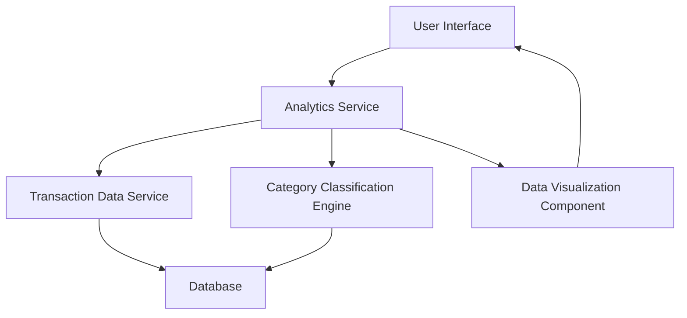

#### 1. High-Level Design

- **Summary**: This epic delivers interactive visualizations and analytical capabilities that enable users to understand their spending patterns through category-wise breakdowns and monthly trend analysis. Users can explore spending across nine predefined categories (Food & Dining, Fuel, Shopping, Travel, Entertainment, Utilities, Healthcare, Education, Miscellaneous) with card-wise spend analysis and monthly spend trends.

- **Component Flow**:

- **Integration Points**: 
  - **Upstream**: Transaction Data Service (for historical spending data)
  - **Upstream**: Category Classification Engine (for transaction categorization into 9 predefined categories)
  - **Downstream**: Data Visualization Component (for rendering interactive charts and graphs)

- **Key Assumptions**: 
  - Transaction data is already categorized or the Category Classification Engine can automatically classify transactions into the 9 predefined categories.
  - Monthly spend trends are calculated based on transaction date timestamps available in the transaction data service.

- **NFR Highlights**: Analytics visualizations must render within 1.5 seconds; System must support filtering and drill-down capabilities; Charts must be responsive and interactive across all device types.

- **Data Flow**: User requests spending analytics through the UI → Analytics Service retrieves historical transaction data from Transaction Data Service → Category Classification Engine categorizes transactions into 9 categories → Analytics Service aggregates data by category, card, and month → Data Visualization Component renders interactive charts → User views category-wise spending, monthly trends, and card-wise analysis with filtering and drill-down capabilities.

#### 2. Validation Report

- **Requirements Coverage**: The design covers all stated requirements including category-wise spending visualization (9 categories), monthly spend trends, card-wise spend analysis, and interactive charts. The architecture supports the NFRs for rendering performance (1.5 seconds), filtering/drill-down capabilities, and responsive design across devices. Integration points with Transaction Data Service and Category Classification Engine are clearly defined to support the epic's scope.