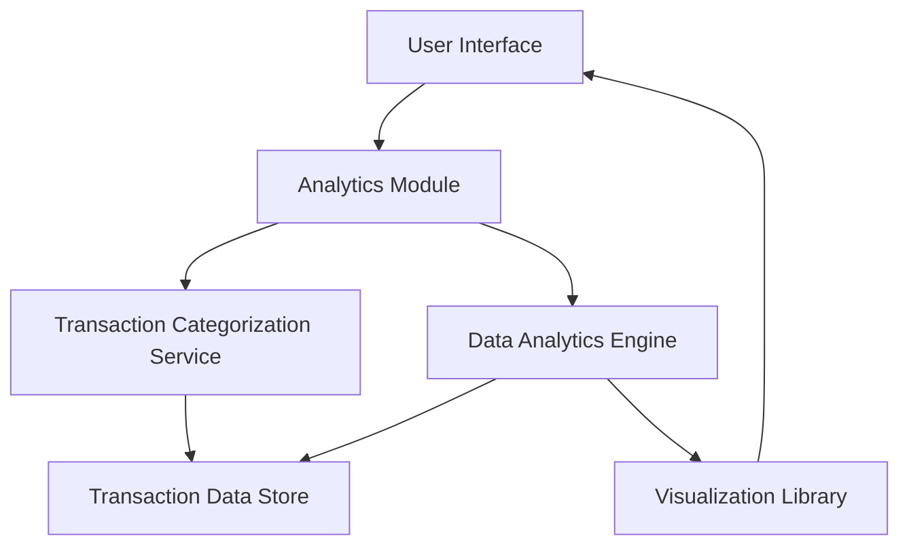

#### 1. High-Level Design

- **Summary**: This epic delivers advanced analytical capabilities through interactive visualizations and trend analysis, enabling users to explore category-wise spending patterns across nine predefined categories and view monthly spend trends over time. The system processes historical transaction data to identify patterns and provide actionable insights for financial decision-making.

- **Component Flow**:

- **Integration Points**: 
  - **Upstream**: Transaction categorization service for accurate category assignment to transactions; Data analytics engine for trend computation and pattern analysis
  - **Downstream**: Visualization library integration for rendering interactive charts; Transaction Data Store for historical data retrieval

- **Key Assumptions**: 
  - Transactions are auto-categorized using predefined rules or ML models into the nine specified categories
  - Historical data retention policy ensures minimum 12 months of transaction history is available

- **NFR Highlights**: Analytics queries must return results within 3 seconds; handle historical data for minimum 12 months; visualizations render smoothly with up to 5000 transactions; interactive and responsive charts across all device types

- **Data Flow**: User selects analytics view (category-wise or trend analysis) → Analytics Module queries Transaction Categorization Service to retrieve categorized transactions → Data Analytics Engine processes transaction data from Transaction Data Store, computing aggregations by category and time period → Computed analytics (spending by category, monthly trends, patterns) are passed to Visualization Library → Interactive charts and graphs are rendered in User Interface → User can interact with visualizations to drill down into specific categories or time periods for detailed insights

#### 2. Validation Report

- **Requirements Coverage**: The design fully addresses the epic's scope including category-wise spending visualization across all nine categories (Food & Dining, Fuel, Shopping, Travel, Entertainment, Utilities, Healthcare, Education, Miscellaneous), monthly spend trend analysis, interactive charts and graphs, spending pattern identification, and historical spending comparison. The responsive analytics visualizations requirement is met through the Visualization Library component. All NFRs are supported: 3-second query response through optimized Data Analytics Engine, 12+ months historical data handling via Transaction Data Store, smooth rendering with 5000+ transactions through efficient visualization rendering, and responsive interactive charts across devices.