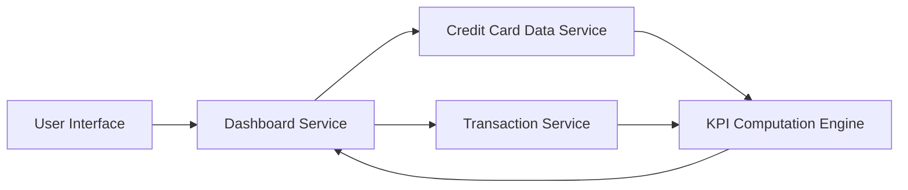

#### 1. High-Level Design

- **Summary**: This epic provides a real-time consolidated dashboard displaying critical financial KPIs across all credit cards, including Monthly Spend, Total Credit Limit, Available Credit, and Outstanding Amount. The dashboard enables users to quickly assess their overall financial position and credit utilization through an intuitive, responsive interface.

- **Component Flow**:

- **Integration Points**: 
  - **Upstream**: Credit Card data service for retrieving card details and balances; Transaction service for calculating monthly spend and outstanding amounts
  - **Downstream**: KPI Computation Engine aggregates data from both services

- **Key Assumptions**: 
  - Data refresh occurs at defined intervals (e.g., every 5 minutes) to achieve near-real-time performance
  - Monthly spend is calculated based on current calendar month transactions

- **NFR Highlights**: Dashboard must load within 2 seconds; real-time or near-real-time data refresh; responsive design for desktop, tablet, and mobile; 99.9% data accuracy maintained

- **Data Flow**: User accesses dashboard → Dashboard Service requests card details from Credit Card Data Service and transaction data from Transaction Service → KPI Computation Engine calculates Monthly Spend (sum of current month transactions), Total Credit Limit (sum of all card limits), Available Credit (Total Limit - Outstanding), and Outstanding Amount (sum of unpaid balances) → Computed KPIs are returned to Dashboard Service → Dashboard renders consolidated metrics in responsive layout for user viewing

#### 2. Validation Report

- **Requirements Coverage**: The design comprehensively addresses all KPI requirements specified in the epic scope: Monthly Spend display, Total Credit Limit calculation and display, Available Credit computation and visualization, Outstanding Amount tracking, and consolidated view of metrics. The responsive dashboard layout and integration with Credit Card and Transaction services ensure all functional requirements are met. NFRs for 2-second load time, real-time refresh, responsive design, and 99.9% accuracy are supported through the KPI Computation Engine and service-oriented architecture.