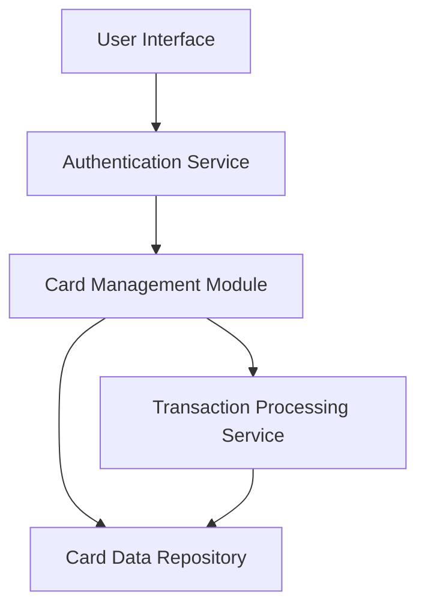

#### 1. High-Level Design

- **Summary**: This epic delivers a unified interface for managing and monitoring multiple credit cards, enabling users to view card details, track spending patterns, analyze card-wise expenditure, and monitor utilization metrics. The system provides comprehensive visibility into each card's limits, balances, and transaction history from a centralized dashboard.

- **Component Flow**:

- **Integration Points**: 
  - **Upstream**: User authentication service for secure access control
  - **Downstream**: Card data repository for persistent storage of card information; Transaction processing service for retrieving card-specific transaction data

- **Key Assumptions**: 
  - Card data is stored in a structured format with standardized fields (card number, limit, balance, etc.)
  - Transaction data is pre-processed and associated with specific card IDs for efficient retrieval

- **NFR Highlights**: System must support minimum 10 credit cards per user; card data retrieval within 1 second; performance maintained with up to 1000 transactions per card; encryption at rest and in transit required

- **Data Flow**: User authenticates → Authentication service validates credentials → Card Management Module retrieves card list from Card Data Repository → For each card, the module fetches transaction history from Transaction Processing Service → Aggregated card details, balances, utilization metrics, and transactions are displayed in the unified interface → User can drill down into individual card details and transaction history

#### 2. Validation Report

- **Requirements Coverage**: The design fully covers the epic's stated scope including multiple credit card display, card-wise spend analysis, individual card details view, card-specific balance tracking, utilization metrics, and transaction history per card. All NFRs regarding performance (1-second retrieval), scalability (10+ cards, 1000+ transactions), and security (encryption) are addressed through the component architecture and integration with dedicated services.