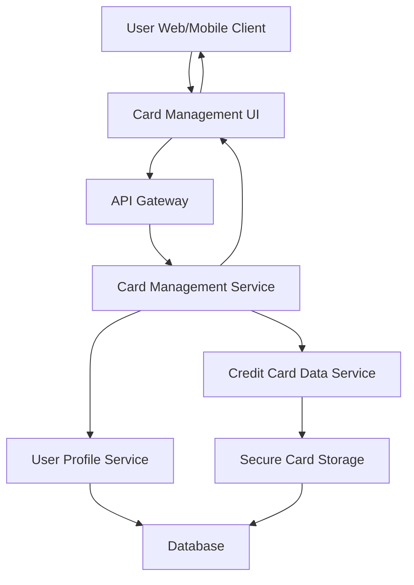

#### 1. High-Level Design

- **Summary:** This epic enables users to manage and view multiple credit cards (up to 10) within a single interface. The core requirement is to provide comprehensive access to individual card details including card-specific limits, balances, available credit, and status, with easy switching and comparison capabilities between different cards.

- **Component Flow:**

- **Integration Points:**
  - **Upstream:** User Profile Service (validates card ownership and user-card associations)
  - **Downstream:** Credit Card Data Service (retrieves card details, limits, balances, and status), Secure Card Storage System (ensures encrypted storage and secure retrieval of sensitive card information)

- **Key Assumptions:**
  - Card information is stored in encrypted format; only masked card numbers are displayed in UI (last 4 digits).
  - Card switching is client-side navigation with server-side data fetch, achieving sub-500ms response time through optimized API calls and caching.

- **NFR Highlights:** System must support display of at least 10 credit cards per user, card switching response time under 500ms, ensure secure storage and display of card information.

- **Data Flow:** User accesses card management interface → Card Management Service validates user identity via User Profile Service → Retrieves list of user's credit cards from Credit Card Data Service → For each card, fetches details (card number masked, credit limit, outstanding balance, available credit, status) from Secure Card Storage → Returns card list to UI → User selects specific card → UI switches view (client-side) and fetches detailed card data (server-side) within 500ms → Displays comprehensive card details with comparison capabilities.

#### 2. Validation Report

- **Requirements Coverage:** The design fully addresses the epic's scope including multiple card display (up to 10 cards), individual card details view, card-wise credit limit display, card-wise outstanding balance, card-wise available credit, and card selection and navigation. All NFRs are met: support for 10+ cards per user through scalable architecture, sub-500ms card switching via optimized API and client-side navigation, secure storage and display through Secure Card Storage System with encryption. All dependencies (Credit Card Data Service, User Profile Service, Secure Card Information Storage System) are properly integrated into the design.