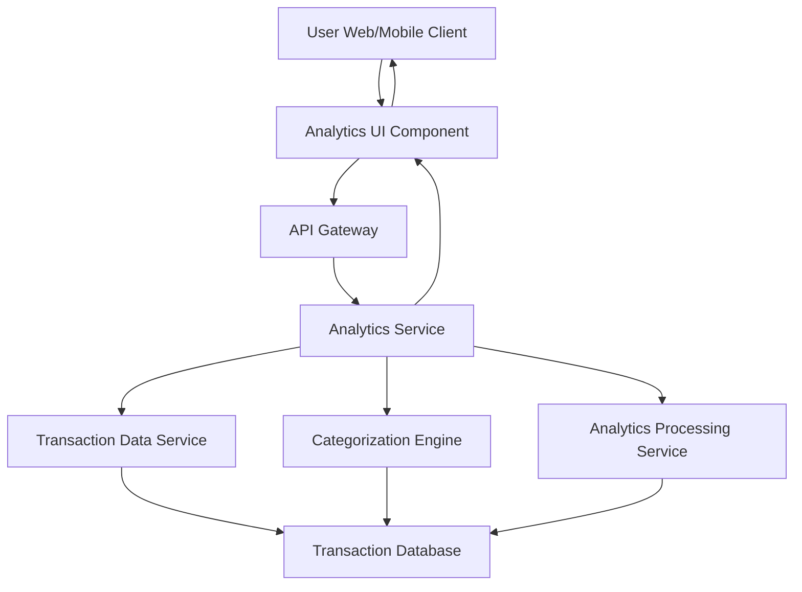

#### 1. High-Level Design

- **Summary:** This epic provides interactive visualizations and analytics capabilities to help users understand their spending patterns. The core requirement is to enable category-wise spending analysis across 9 predefined categories (Food & Dining, Fuel, Shopping, Travel, Entertainment, Utilities, Healthcare, Education, Miscellaneous), monthly trend analysis, and card-wise spend breakdown through interactive charts and graphs.

- **Component Flow:**

- **Integration Points:**
  - **Upstream:** Transaction Data Service (provides historical transaction records for at least 12 months)
  - **Downstream:** Categorization Engine (classifies transactions into 9 predefined categories), Analytics Processing Service (calculates trends, aggregations, and spending patterns)

- **Key Assumptions:**
  - Transaction categorization is automated using rule-based or ML-based Categorization Engine; manual re-categorization by users is not in scope.
  - Analytics data is pre-computed and cached for performance, refreshed daily or on-demand with acceptable 3-second rendering time.

- **NFR Highlights:** Analytics visualizations must render within 3 seconds, support interactive filtering and drill-down capabilities, handle transaction history of at least 12 months, ensure accurate categorization of transactions.

- **Data Flow:** User requests analytics view → Analytics Service retrieves transaction history (12 months) from Transaction Data Service → Categorization Engine classifies transactions into 9 categories → Analytics Processing Service aggregates data (category-wise totals, monthly trends, card-wise breakdown) → Processed analytics data returned to Analytics UI → UI renders interactive charts (pie charts for categories, line graphs for trends, bar charts for card comparison) with filtering and drill-down capabilities.

#### 2. Validation Report

- **Requirements Coverage:** The design comprehensively covers the epic's scope including category-wise spending visualization across 9 predefined categories, monthly spend trend analysis, card-wise spend analysis, interactive charts and graphs, and spending pattern identification. All NFRs are addressed: 3-second rendering through pre-computed analytics, interactive filtering via UI component capabilities, 12-month transaction history support through Transaction Data Service, and accurate categorization via dedicated Categorization Engine. All dependencies (Transaction Data Service, Categorization Engine, Analytics Processing Service) are integrated.