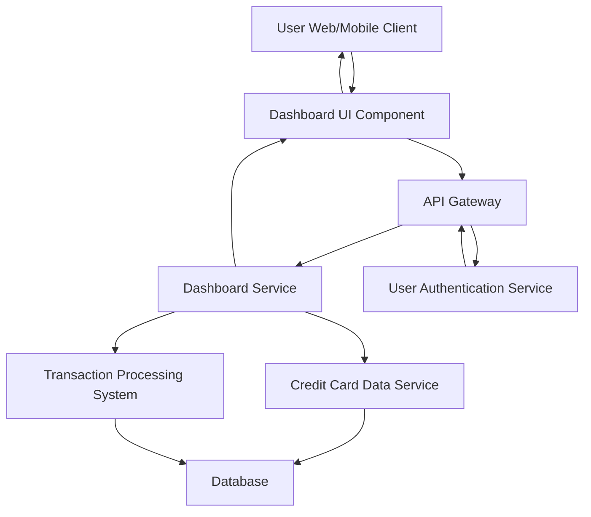

#### 1. High-Level Design

- **Summary:** This epic delivers a consolidated dashboard that aggregates and displays key performance indicators (KPIs) across all user credit cards. The core requirement is to provide real-time visibility into monthly spend, total credit limit, available credit, and outstanding amounts in a unified interface, enabling users to monitor their overall credit card portfolio health at a glance.

- **Component Flow:**

- **Integration Points:**
  - **Upstream:** User Authentication Service (for user identity verification and session management)
  - **Downstream:** Credit Card Data Service (retrieves card details, limits, and balances), Transaction Processing System (provides spend calculations and transaction data)

- **Key Assumptions:**
  - Data refresh frequency is assumed to be near real-time (polling or event-driven updates every 30-60 seconds).
  - Financial calculations (available credit = total limit - outstanding) are performed server-side to ensure accuracy and consistency.

- **NFR Highlights:** Dashboard must load within 2 seconds, support real-time data refresh, ensure responsive design across desktop and mobile devices, maintain data accuracy for financial calculations.

- **Data Flow:** User authenticates via Authentication Service → Dashboard Service fetches user's credit card list from Credit Card Data Service → Retrieves current balances and limits from database → Fetches monthly spend data from Transaction Processing System → Aggregates metrics (total credit limit, total outstanding, total available credit, monthly spend) → Returns consolidated KPIs to Dashboard UI → UI renders responsive dashboard with real-time metrics.

#### 2. Validation Report

- **Requirements Coverage:** The design fully covers the epic's stated scope including monthly spend display, total credit limit aggregation, available credit calculation, outstanding amount tracking, multi-card consolidated view, and responsive dashboard layout. All NFRs (2-second load time, real-time refresh, responsive design, data accuracy) are addressed through appropriate architectural choices (API Gateway for performance, server-side calculations for accuracy, responsive UI component). All stated dependencies (Credit Card Data Service, Transaction Processing System, User Authentication Service) are integrated into the component flow.