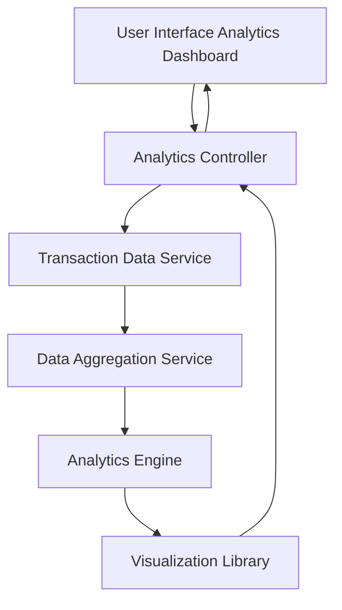

### 1. High-Level Design

**Summary:**  
This epic provides interactive visualizations and analytics to help users understand spending patterns across 9 predefined categories (Food & Dining, Fuel, Shopping, Travel, Entertainment, Utilities, Healthcare, Education, Miscellaneous). Users can view monthly spend trends, analyze category-wise distribution, and track spending patterns over time through interactive charts and graphs with drill-down capabilities, supporting at least 12 months of historical data.

**Component Flow:**

**Integration Points:**
- **Upstream:** Transaction Data Service (provides raw transaction data with category information)
- **Downstream:** Analytics Engine (performs data analysis and pattern recognition), Data Aggregation Service (aggregates transactions by category and time period), Visualization Library (renders interactive charts and graphs)

**Key Assumptions:**
- Transactions are pre-categorized into the 9 predefined categories by the Transaction Data Service or an upstream categorization engine.
- Historical data for 12 months is readily available and optimized for analytical queries to meet the 3-second rendering requirement.

**NFR Highlights:**  
Analytics visualizations must render within 3 seconds, support interactive filtering and drill-down capabilities, handle historical data for at least 12 months.

### 2. Validation Report

**Requirements Coverage:**  
The design comprehensively covers all scope elements including category-wise spending visualization, monthly spend trends, interactive charts and graphs, spending pattern analysis, and multi-category tracking across the 9 predefined categories. All NFRs (3-second rendering, interactive filtering/drill-down, 12-month historical data) are addressed through the analytics engine and data aggregation service architecture. All four integration dependencies (Transaction Data Service, Analytics Engine, Data Aggregation Service, Visualization Library) are explicitly mapped. Out-of-scope items (real bank integration, predictive analytics, budget recommendations, spending alerts, payment gateway integration) are appropriately excluded from the design.