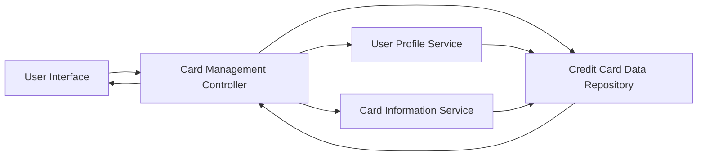

### 1. High-Level Design

**Summary:**  
This epic enables users to manage and view multiple credit cards (up to 10 per user) within a single unified interface. Users can add, view, monitor, and switch between credit cards, with each card displaying relevant details such as card information, limits, balances, and card-wise spending analysis. The feature centralizes credit card management to eliminate the need for switching between multiple applications.

**Component Flow:**

**Integration Points:**
- **Upstream:** User Profile Service (manages user-card associations and preferences)
- **Downstream:** Credit Card Data Repository (persistent storage for card information), Card Information Service (retrieves and validates card details)

**Key Assumptions:**
- Card addition process assumes cards are pre-validated or linked through an external onboarding process not covered in this epic.
- Card data retrieval is optimized through indexing to meet the 500ms latency requirement for up to 10 cards per user.

**NFR Highlights:**  
System must support at least 10 credit cards per user, card data retrieval latency under 500ms, secure storage and display of card information.

### 2. Validation Report

**Requirements Coverage:**  
The design addresses all scope elements including multiple credit card display, card-wise information view, card details presentation, card selection and switching, and card-wise spend analysis. NFRs for supporting 10 cards per user, sub-500ms retrieval latency, and secure storage are incorporated through the architecture. All three integration dependencies (User Profile Service, Credit Card Data Repository, Card Information Service) are explicitly included in the component flow. The out-of-scope items (real bank integration, payments, fund transfers, card application process) are respected and not included in the design.