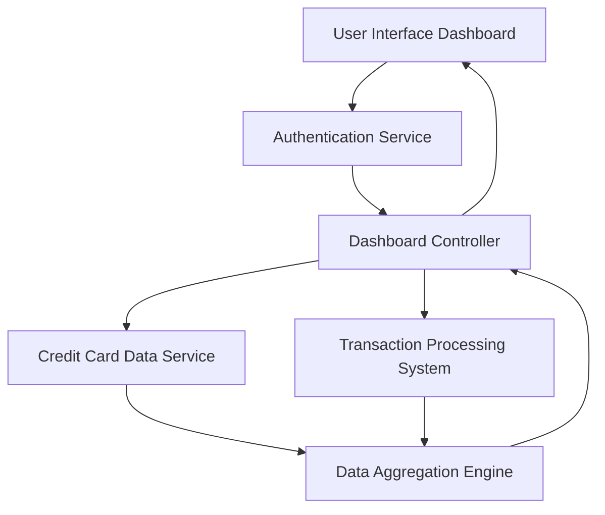

### 1. High-Level Design

**Summary:**  
This epic delivers a consolidated financial dashboard that displays key credit card metrics including monthly spending, total credit limit, available credit, and outstanding amounts across all user credit cards. The dashboard provides real-time visibility into overall credit card financial health through a responsive interface accessible on both mobile and desktop devices.

**Component Flow:**

**Integration Points:**
- **Upstream:** User Authentication Service (for user identity verification)
- **Downstream:** Credit Card Data Service (retrieves card information and limits), Transaction Processing System (provides spending and outstanding amount data)

**Key Assumptions:**
- Financial data is aggregated and cached at regular intervals (assumed every 5-15 minutes) to meet the 2-second load requirement while maintaining "real-time" visibility.
- Card data format follows a standardized schema across all credit cards in the system.

**NFR Highlights:**  
Dashboard must load within 2 seconds, support responsive design for mobile and desktop devices, handle real-time data refresh for financial metrics.

### 2. Validation Report

**Requirements Coverage:**  
The design fully covers the epic's stated scope including monthly spend display, total credit limit calculation, available credit tracking, outstanding amount monitoring, responsive dashboard layout, and consolidated multi-card view. All NFRs (2-second load time, responsive design, real-time refresh) are addressed through the data aggregation engine and caching strategy. Integration dependencies with credit card data service, transaction processing system, and user authentication service are explicitly mapped in the component flow.