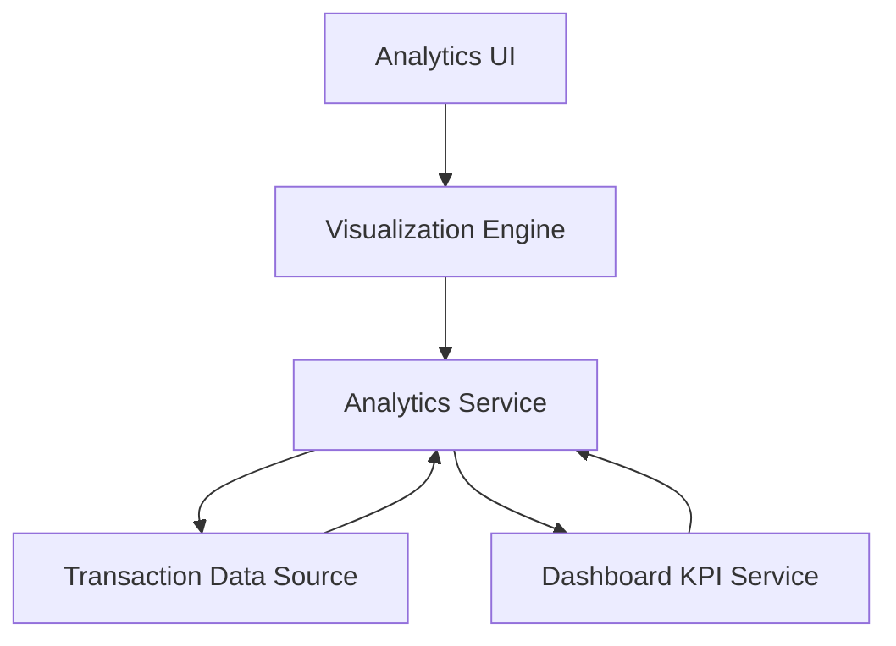

### 1. High-Level Design

**Summary:**  
This epic delivers interactive visualizations and analytical capabilities enabling users to understand spending patterns across categories and time periods. It provides category-wise breakdowns (Food & Dining, Fuel, Shopping, Travel, Entertainment, Utilities, Healthcare, Education, Miscellaneous), monthly spend trends, and card-wise spend analysis through interactive charts and graphs.

**Component Flow:**

**Integration Points:**
- **Upstream:** Transaction Management system for detailed transaction data
- **Upstream:** Dashboard KPI service for aggregated financial metrics
- **External:** Data visualization library (e.g., Chart.js, D3.js, Recharts) for rendering interactive charts
- **Downstream:** None specified; this is primarily a presentation/analysis layer

**Key Assumptions:**
- Transactions are pre-categorized into the nine specified categories at the time of ingestion or through a separate categorization service.
- Analytics aggregations are computed on-demand with caching for frequently accessed time periods (e.g., current month, last 3 months).

**NFR Highlights:**  
Visualizations render within 2 seconds; interactive and responsive charts across all devices; supports real-time or near-real-time data updates for accurate trend analysis.

### 2. Validation Report

**Requirements Coverage:**  
The design fully addresses the epic's scope including category-wise spending visualization across nine predefined categories, monthly spend trends, card-wise analysis, and interactive chart rendering. The architecture clearly delineates the visualization layer (UI + Visualization Engine) from the analytics computation layer (Analytics Service) and data sources (Transaction Data, Dashboard KPIs). The 2-second rendering NFR is architecturally supported through server-side aggregation and client-side visualization optimization. Integration dependencies with Transaction Management and Dashboard KPI systems are explicitly represented. The design naturally excludes out-of-scope items (predictive forecasts, budget alerts, custom categories, exports) while providing the foundation for future enhancements. All stated NFRs regarding responsiveness and real-time updates are addressed through the component architecture.