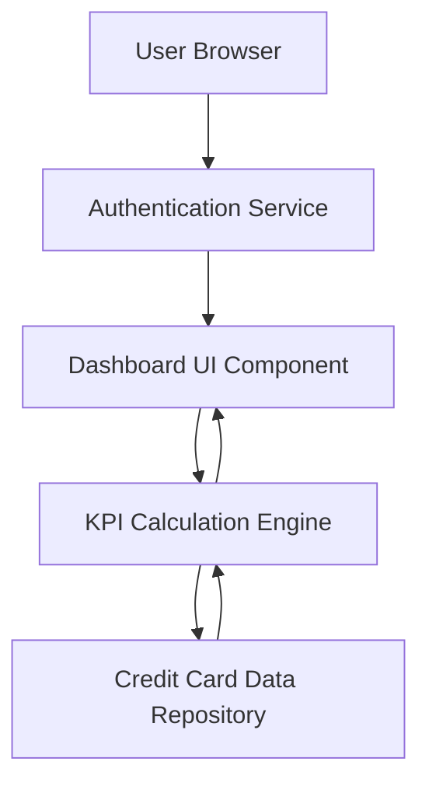

### 1. High-Level Design

**Summary:**  
This epic delivers a comprehensive dashboard that consolidates all user credit cards into a single view, displaying key performance indicators including monthly spend, total credit limit, available credit, and outstanding amounts. The dashboard serves as the primary entry point for users to monitor their credit card portfolio health and financial standing through a modern, responsive interface.

**Component Flow:**

**Integration Points:**
- **Upstream:** User authentication service for secure access control
- **Downstream:** Credit card data source/repository for retrieving card details and financial data
- **Internal:** Links to Transaction Management system for detailed transaction data

**Key Assumptions:**
- Credit card data is available in a structured format (JSON/REST API) with standardized fields for card details and financial metrics.
- KPI calculations (available credit, utilization) are performed server-side with cached results refreshed periodically (e.g., every 5 minutes).

**NFR Highlights:**  
Responsive design across desktop/tablet/mobile; dashboard load time under 2 seconds; must handle multiple credit cards without performance degradation.

### 2. Validation Report

**Requirements Coverage:**  
The design fully covers the epic's stated scope including dashboard interface development, multiple credit card display, KPI tracking (monthly spend, credit limit, available credit, outstanding amounts), and responsive layout implementation. The component flow demonstrates clear separation between UI, business logic (KPI calculation), and data access layers. All specified NFRs (responsive design, 2-second load time, multi-card performance) are architecturally supported through client-side rendering optimization and server-side KPI computation. Integration dependencies with authentication and credit card data sources are explicitly addressed in the architecture.