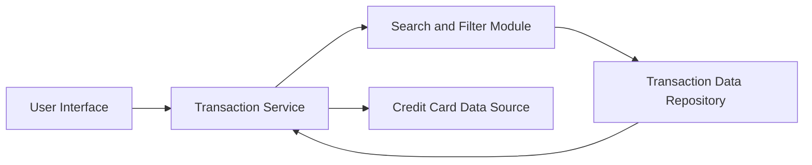

### 1. High-Level Design

**Summary:**  
This epic enables users to view, track, and manage credit card transactions across all their cards. It provides detailed transaction histories with filtering and search capabilities, supporting users in understanding spending behavior and reconciling statements. This component serves as the foundational data layer for analytics and reporting features.

**Component Flow:**

**Integration Points:**
- **Upstream:** Credit card data source for card identification and validation
- **Downstream:** Transaction data repository/service for retrieving transaction records
- **Internal:** Provides transaction data to Dashboard KPI calculations and Spending Analytics systems

**Key Assumptions:**
- Transactions are stored with standardized attributes (date, amount, merchant, category, card ID) in a queryable database.
- Pagination is implemented for transaction lists with default page size of 50 transactions to ensure 3-second retrieval performance.

**NFR Highlights:**  
Must efficiently handle large transaction volumes; transaction retrieval and display within 3 seconds; clear, scannable data presentation across all device types.

### 2. Validation Report

**Requirements Coverage:**  
The design comprehensively addresses the epic's scope including transaction listing, detail views, multi-card aggregation, history access, and filtering/search capabilities. The architecture separates concerns between presentation (UI), business logic (Transaction Service), search functionality, and data persistence. The 3-second retrieval NFR is supported through optimized query patterns and pagination strategy. The design explicitly accounts for integration with both upstream credit card data sources and downstream consumers (Dashboard KPIs, Analytics). All stated dependencies are architecturally represented, and the out-of-scope items (payments, transfers, transaction editing) are naturally excluded from the component design.