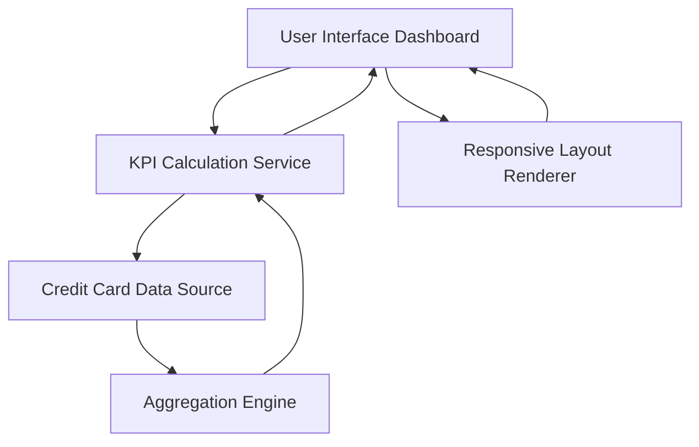

#### 1. High-Level Design

- **Summary:** This epic delivers a modern, responsive dashboard serving as the central interface for credit card financial health monitoring. The dashboard aggregates data from multiple credit cards to display key performance indicators including monthly spend, total credit limit, available credit, and outstanding amount. It provides users with immediate visibility into credit utilization and spending patterns through a consolidated multi-card view, enabling informed financial decision-making at a glance.

- **Component Flow:**

- **Integration Points:**
  - **Upstream:** Credit card data source or mock data service for retrieving card information, balances, limits, and transaction summaries
  - **Internal:** KPI calculation service for computing monthly spend, total credit limit, available credit, and outstanding amounts
  - **Internal:** Aggregation engine for consolidating data across multiple credit cards

- **Key Assumptions:**
  - Card data source provides real-time or near-real-time data with sufficient freshness to support 2-second dashboard load time
  - KPI calculations (monthly spend, available credit) are computed server-side to minimize client-side processing

- **NFR Highlights:** System must support responsive design across desktop, tablet, and mobile devices; dashboard load time must be under 2 seconds; UI must be accessible and compliant with WCAG 2.1 standards

- **Data Flow:** User accesses dashboard → UI requests KPI data from KPI Calculation Service → Service queries Credit Card Data Source for all user cards → Raw card data (balances, limits, recent transactions) is passed to Aggregation Engine → Engine calculates consolidated KPIs (total monthly spend across all cards, sum of credit limits, total available credit, total outstanding amount) → KPIs are returned to UI → Responsive Layout Renderer formats data for user's device → Dashboard displays consolidated view with all KPIs and multi-card summary

#### 2. Validation Report

- **Requirements Coverage:** The design fully addresses the epic's scope including dashboard interface implementation, monthly spend KPI display, total credit limit calculation/display, available credit calculation/display, outstanding amount tracking, responsive layout for multiple devices, and multi-card consolidated view. All NFRs (responsive design, 2-second load time, WCAG 2.1 compliance) are incorporated into the architecture through the responsive layout renderer and performance-optimized service design. Integration dependency with credit card data source is explicitly mapped. Out-of-scope items (real bank integration, payments, fund transfers, loans) are appropriately excluded from the design.