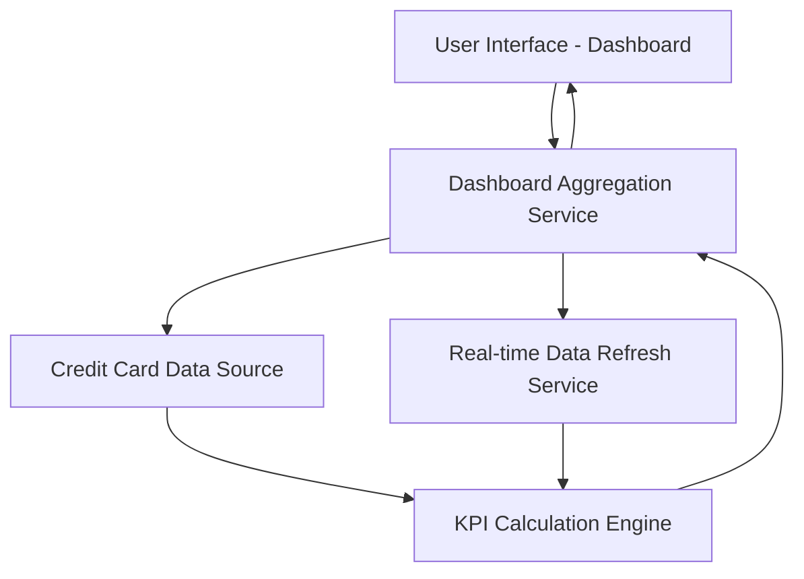

#### 1. High-Level Design

- **Summary:** This epic enables users to view consolidated financial metrics across all their credit cards through a modern, responsive dashboard interface. Users can monitor critical financial indicators including monthly spend, total credit limit, available credit, and outstanding amounts in real-time. The dashboard provides a single-pane view that aggregates data from multiple credit cards, allowing users to quickly assess their overall credit health and financial position.

- **Component Flow:**

- **Integration Points:** 
  - **Upstream:** Credit card data source or mock data service for retrieving card balances, limits, and transaction data
  - **Internal:** Real-time data refresh service for periodic updates (supporting up to 50 credit cards per user)

- **Key Assumptions:** 
  - KPI calculations (total credit limit, available credit, outstanding amounts, monthly spend) are computed on-demand or cached with periodic refresh.
  - Dashboard supports responsive design through adaptive UI components; data aggregation logic handles up to 50 cards efficiently.

- **NFR Highlights:** Dashboard must load within 2 seconds, support responsive design for mobile and desktop devices, handle real-time data refresh for up to 50 credit cards per user.

- **Data Flow:** User accesses dashboard → Dashboard Aggregation Service requests data from Credit Card Data Source → Real-time Data Refresh Service ensures latest data is available → KPI Calculation Engine computes consolidated metrics (total credit limit = sum of all card limits, available credit = sum of available across cards, outstanding = sum of balances, monthly spend = sum of current month transactions) → Aggregated KPIs and consolidated view returned to responsive UI → Dashboard displays single-pane view with all critical financial indicators updated in real-time.

#### 2. Validation Report

- **Requirements Coverage:** The design fully addresses the epic's scope including monthly spend display, total credit limit calculation, available credit tracking, outstanding amount monitoring, responsive dashboard layout, and consolidated multi-card view. All NFRs are met: 2-second load time is achievable through optimized aggregation and caching strategies, responsive design is implemented through adaptive UI components, and real-time data refresh for up to 50 cards is supported by the dedicated refresh service. The dependency on credit card data source or mock data service is clearly identified and integrated into the component flow.