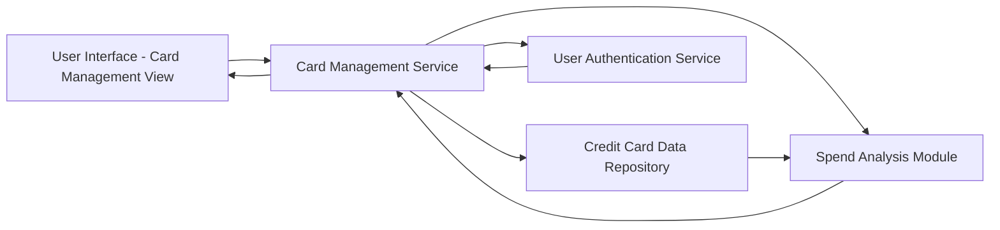

#### 1. High-Level Design

- **Summary:** This epic provides users with the ability to view and manage multiple credit cards within a single interface. Users can see individual card details, compare card-wise spending, and access card-specific information such as credit limits, balances, and utilization rates. The feature supports adding multiple cards to the dashboard and provides card-wise spend analysis to help users understand which cards are being used most frequently and for what purposes.

- **Component Flow:**

- **Integration Points:** 
  - **Upstream:** Credit card data repository or service for storing and retrieving multiple card information
  - **Upstream:** User authentication service for secure access and data isolation
  - **Internal:** Spend analysis module for card-wise spending calculations

- **Key Assumptions:** 
  - Card data includes card number (masked), credit limit, current balance, and utilization percentage; data is refreshed periodically.
  - User authentication is handled by an existing identity management system; card data is isolated per authenticated user.

- **NFR Highlights:** System must support minimum 10 credit cards per user, card data retrieval must complete within 1 second, ensure data isolation and security for sensitive card information.

- **Data Flow:** User authenticates → Authentication Service validates user → User requests card portfolio view → Card Management Service retrieves all cards for authenticated user from Credit Card Data Repository → Spend Analysis Module calculates card-wise spending, utilization rates, and comparison metrics → Aggregated card details and analytics returned to UI → User can view individual card details, compare cards, and track utilization across portfolio.

#### 2. Validation Report

- **Requirements Coverage:** The design comprehensively covers the epic's scope including multiple credit card display, card-wise spend analysis, individual card details view, card comparison functionality, and card utilization tracking. All NFRs are addressed: support for minimum 10 cards per user is handled by the data repository design, 1-second retrieval time is achievable through indexed queries and caching, and data isolation/security is enforced through the authentication service integration. Dependencies on credit card data repository and user authentication service are clearly mapped to the architecture.