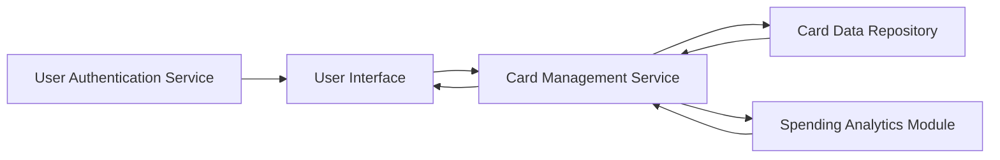

#### 1. High-Level Design

- **Summary:** This epic provides a comprehensive credit card portfolio management interface enabling users to view, monitor, and manage multiple credit cards from a unified dashboard. Users can access individual card details, track card-specific spending, switch between cards, and view consolidated portfolio information. The system retrieves card data from a secure repository, presents it through an intuitive interface, and enables real-time monitoring of balances, limits, and spending across up to 20 cards per user.

- **Component Flow:**

- **Integration Points:**
  - **Upstream:** User authentication service for secure access control and user identity verification
  - **Upstream:** Card data repository/service for storing and retrieving card information, balances, limits, and metadata
  - **Internal:** Spending analytics module for card-wise spend analysis and tracking

- **Key Assumptions:**
  - Card data is stored with sufficient detail (card number masked, issuer, type, limits, balances) to support portfolio management
  - User authentication is handled by an existing enterprise authentication service (OAuth/SSO assumed)

- **NFR Highlights:** System must handle up to 20 credit cards per user without performance degradation; card data refresh must occur within 3 seconds; data must be securely stored and transmitted using encryption

- **Data Flow:** User authenticates via Authentication Service → User Interface requests card portfolio data → Card Management Service queries Card Data Repository for all cards associated with user → Service retrieves card-specific spending data from Spending Analytics Module → Aggregated card information (details, balances, limits, spending) is returned to UI → User can select/switch cards to view individual card details → Selected card data is displayed with real-time balance and limit information

#### 2. Validation Report

- **Requirements Coverage:** The design comprehensively covers all scope elements including multiple credit card display, card-wise spend analysis, individual card detail views, card selection/switching functionality, and card-specific balance/limit tracking. NFRs for handling 20 cards, 3-second refresh time, and secure data transmission are addressed through the service architecture and integration with authentication. Dependencies on user authentication service and card data repository are explicitly mapped. Out-of-scope items (real bank integration, payments, fund transfers, card applications) are appropriately excluded.