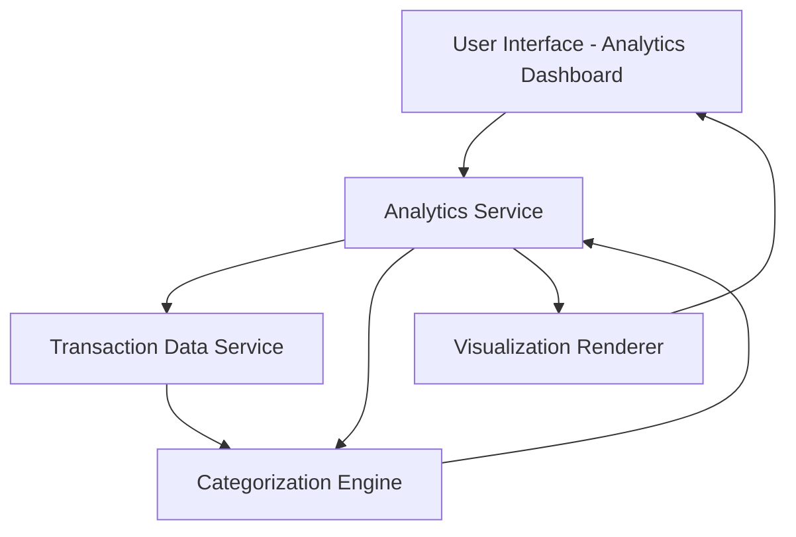

#### 1. High-Level Design

- **Summary:** This epic delivers interactive visualizations and analytical capabilities that help users understand their spending behavior over time. Users can explore monthly spend trends, analyze category-wise spending patterns across nine predefined categories (Food & Dining, Fuel, Shopping, Travel, Entertainment, Utilities, Healthcare, Education, and Miscellaneous), and gain insights into their financial habits. The analytics engine processes transaction data to generate meaningful visualizations that reveal spending patterns and trends.

- **Component Flow:**

- **Integration Points:** 
  - **Upstream:** Transaction data service for historical transaction records (up to 12 months)
  - **Internal:** Categorization engine or service for classifying transactions into 9 predefined categories
  - **Downstream:** Visualization rendering components for charts and graphs

- **Key Assumptions:** 
  - Transaction data is pre-fetched and stored in a structured format with timestamps and amounts.
  - Categorization logic is rule-based or ML-based with 95% accuracy target; categories are fixed and not user-customizable.

- **NFR Highlights:** Analytics visualizations must render within 3 seconds, support filtering and drill-down capabilities, handle transaction history of up to 12 months, ensure accurate categorization of transactions with 95% accuracy.

- **Data Flow:** User requests analytics view → Analytics Service fetches historical transactions from Transaction Data Service → Categorization Engine classifies transactions into 9 categories → Processed data is aggregated by month and category → Visualization Renderer generates interactive charts (trend lines, pie charts, bar graphs) → Rendered visualizations displayed to user with filtering and drill-down options.

#### 2. Validation Report

- **Requirements Coverage:** The design fully covers the epic's stated scope including monthly spend trends visualization, category-wise spending analysis across 9 categories, interactive charts and graphs, spending pattern identification, transaction categorization, and historical trend analysis. All NFRs (3-second render time, 12-month history, 95% categorization accuracy) are addressed through appropriate service layers and caching strategies. Integration dependencies on transaction data service and categorization engine are clearly identified and mapped to the component flow.