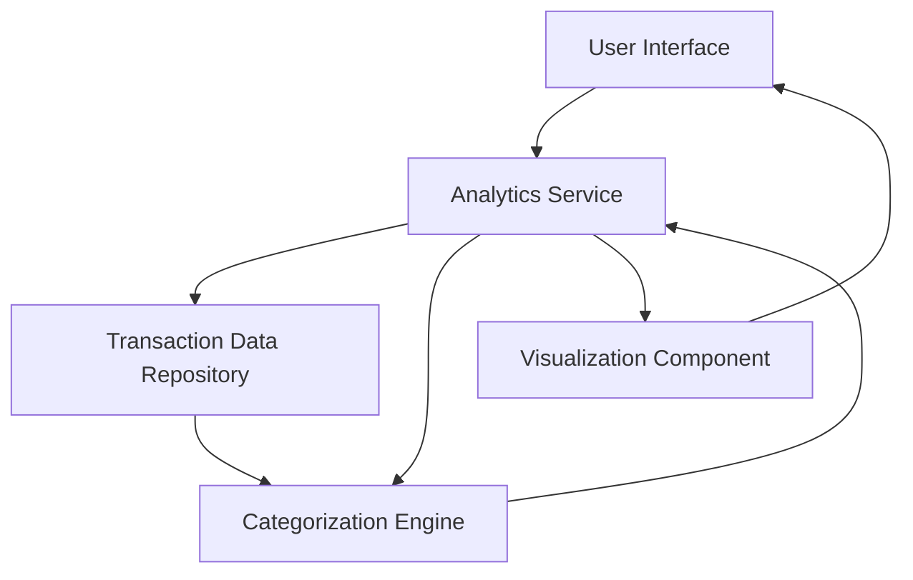

#### 1. High-Level Design

- **Summary:** This epic delivers an interactive analytics and visualization module that processes transaction data to provide category-wise spending analysis and monthly trend insights. Users can explore spending across 9 predefined categories (Food & Dining, Fuel, Shopping, Travel, Entertainment, Utilities, Healthcare, Education, Miscellaneous) through visual representations including charts and graphs. The system retrieves historical transaction data, categorizes it, and presents aggregated insights to help users understand and optimize their spending behavior.

- **Component Flow:**

- **Integration Points:**
  - **Upstream:** Transaction data service/repository for retrieving historical transaction records (up to 12 months)
  - **Downstream:** Categorization engine/service for classifying transactions into 9 predefined spending categories
  - **Internal:** Visualization component for rendering interactive charts and graphs

- **Key Assumptions:**
  - Transaction data is pre-stored with sufficient metadata (merchant name, amount, date) to enable accurate categorization
  - Categorization logic is either rule-based or ML-driven and is maintained by a separate service/module

- **NFR Highlights:** Analytics visualizations must render within 1.5 seconds; system must handle 12 months of transaction history without performance degradation; charts must be interactive and responsive across all device types

- **Data Flow:** User requests spending analytics → Analytics Service queries Transaction Data Repository for historical transactions → Transactions are passed to Categorization Engine which classifies them into 9 predefined categories → Categorized data is aggregated by category and time period → Visualization Component renders interactive charts/graphs showing category-wise spending and monthly trends → Results displayed to user through UI

#### 2. Validation Report

- **Requirements Coverage:** The design fully covers the epic's stated scope including category-wise spending visualization, monthly spend trend analysis, interactive charts, transaction categorization across 9 categories, spending pattern identification, and transaction history display. All NFRs (1.5 second render time, 12-month history support, responsive charts) are addressed through the component architecture. Integration dependencies with transaction data service and categorization engine are explicitly mapped. Out-of-scope items (real bank integration, payments, custom categories, transaction editing) are appropriately excluded from the design.