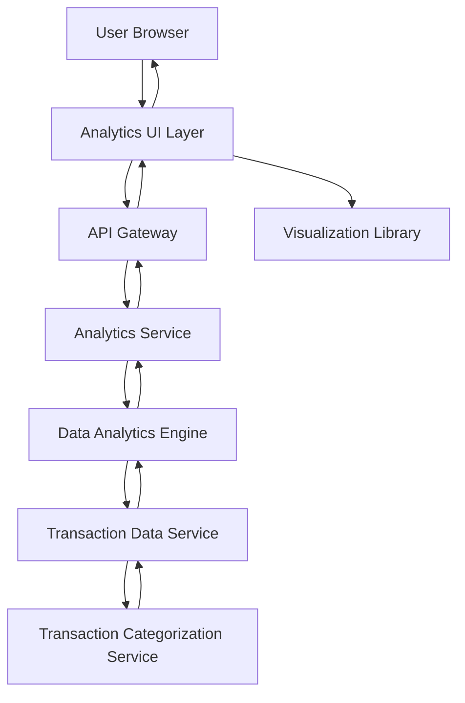

#### 1. High-Level Design

- **Summary:** This epic delivers interactive spending analytics and visualizations that help users understand their spending patterns across nine predefined categories. The system provides category-wise breakdowns, monthly trend analysis, and card-wise spend analysis through interactive charts and graphs, transforming raw transaction data into actionable financial insights.

- **Component Flow:**

- **Integration Points:**
  - **Upstream:** Transaction data service (for retrieving historical transaction data), Transaction categorization service (for category mappings)
  - **Downstream:** Data analytics engine (for aggregation and trend calculation), Visualization library (client-side charting framework)

- **Key Assumptions:** 
  - Historical transaction data is pre-aggregated for common time periods (monthly, quarterly) to optimize query performance.
  - The nine spending categories are fixed and applied consistently across all transactions; custom categories are out of scope.

- **NFR Highlights:** Analytics visualizations must render within 3 seconds; support filtering and drill-down; responsive and interactive charts; handle 12+ months of historical data.

- **Data Flow:** User navigates to analytics dashboard → Analytics UI requests aggregated spending data via API Gateway → Analytics Service queries Data Analytics Engine with user ID and date range → Engine retrieves transaction data from Transaction Data Service → Transactions are grouped by category (using Transaction Categorization Service mappings) and aggregated by month/card → Aggregated data is returned to Analytics Service → Analytics Service formats data for visualization → UI renders interactive charts using Visualization Library (category-wise pie/bar chart, monthly trend line chart, card-wise comparison) → User can filter by date range, category, or card for drill-down analysis.

#### 2. Validation Report

- **Requirements Coverage:** The design fully addresses the epic's scope including category-wise spending visualization (nine categories), monthly spend trend analysis, card-wise spend analysis, interactive charts, and spending pattern identification. NFRs are met through pre-aggregated data and caching (3-second render time), interactive charting library (filtering and drill-down), responsive design, and efficient data storage (12+ months historical data). The architecture separates data aggregation (Analytics Engine) from presentation (Visualization Library) for optimal performance and maintainability.