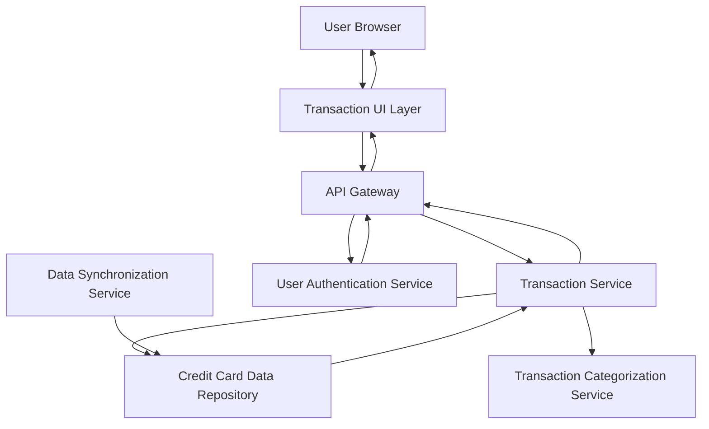

#### 1. High-Level Design

- **Summary:** This epic provides comprehensive transaction tracking and management across all user credit cards. Users can view detailed transaction histories, search and filter by various criteria, and access granular transaction details including merchant, date, amount, and category. The system serves as the authoritative record-keeping layer for all credit card activity.

- **Component Flow:**

- **Integration Points:**
  - **Upstream:** User authentication service (for access control), Data synchronization service (for ingesting transaction data from external sources)
  - **Downstream:** Credit card data repository (for transaction storage and retrieval), Transaction categorization service (for automatic category assignment)

- **Key Assumptions:** 
  - Transactions are synchronized from external sources at least daily; real-time transaction posting is not required.
  - Transaction categorization is automated with 90%+ accuracy; manual re-categorization is handled separately.

- **NFR Highlights:** System must handle up to 10,000 transactions per user; transaction queries must return results within 1 second; secure storage with audit trails; support for concurrent access.

- **Data Flow:** User authenticates → User requests transaction list with optional filters via UI → API Gateway routes request to Transaction Service → Transaction Service queries Credit Card Data Repository with search/filter criteria → Transactions are retrieved and enriched with category data from Transaction Categorization Service → Results are returned to UI with pagination → User can drill down into individual transaction details for merchant, date, amount, and category information.

#### 2. Validation Report

- **Requirements Coverage:** The design comprehensively covers all stated requirements including transaction list view, detail display, search and filtering, multi-card aggregation, categorization, and date/amount display. NFRs are addressed through indexed database queries (1-second response), scalable data repository (10,000 transactions per user), audit logging, and stateless API design for concurrency. The architecture supports the epic's role as the detailed record-keeping layer feeding dashboard KPIs and analytics.