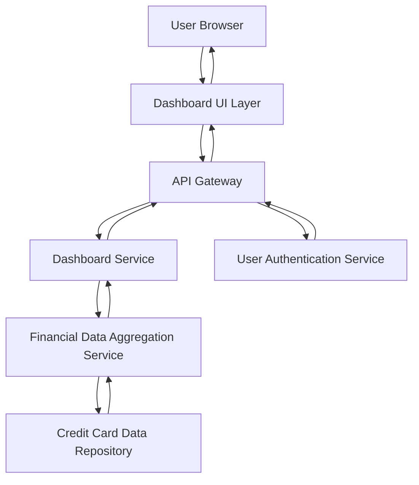

#### 1. High-Level Design

- **Summary:** This epic delivers a consolidated credit card portfolio dashboard that aggregates and displays key financial metrics across multiple credit cards. Users can monitor monthly spend, total credit limits, available credit, and outstanding balances from a single interface, providing a comprehensive view of their credit utilization and financial position.

- **Component Flow:**

- **Integration Points:**
  - **Upstream:** User authentication service (for user identity verification and session management)
  - **Downstream:** Credit card data repository (for retrieving card details and balances), Financial data aggregation service (for computing KPIs and metrics)

- **Key Assumptions:** 
  - Credit card data is refreshed in near real-time (within 5 minutes) from source systems.
  - Users have pre-registered credit cards in the system; card enrollment is handled by a separate process.

- **NFR Highlights:** Dashboard must load within 2 seconds; real-time data refresh; responsive design for desktop, tablet, and mobile; encryption at rest and in transit.

- **Data Flow:** User authenticates → Dashboard UI requests portfolio data via API Gateway → Dashboard Service queries Financial Data Aggregation Service → Aggregation Service retrieves card details from Credit Card Data Repository → KPIs (monthly spend, credit limits, available credit, outstanding amounts) are calculated and returned → Dashboard UI renders consolidated view with all cards and metrics.

#### 2. Validation Report

- **Requirements Coverage:** The design fully covers the epic's stated scope including dashboard interface, multiple credit card display, KPI tracking (monthly spend, credit limits, available credit, outstanding amounts), and responsive layout. All NFRs (2-second load time, real-time refresh, responsive design, encryption) are addressed through appropriate architectural components (caching, API Gateway, responsive UI framework, secure data transmission).