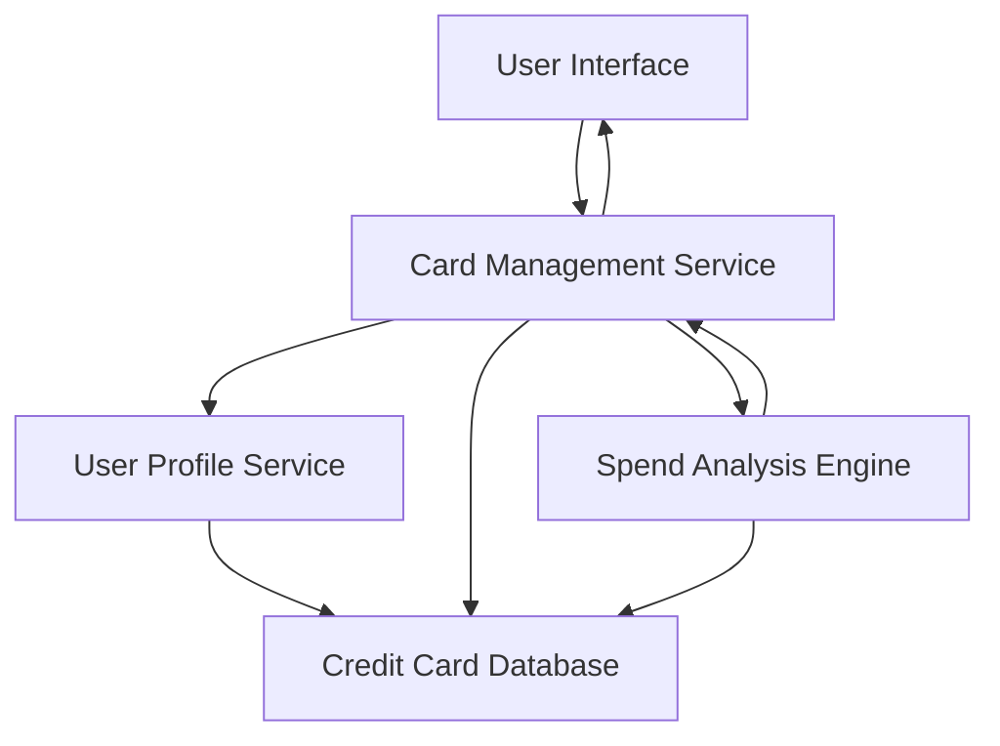

#### 1. High-Level Design

- **Summary:** This epic enables users to manage and monitor multiple credit cards within a single platform. Users can view all their credit cards in one place with individual card details including card-specific credit limits, balances, and usage. The feature provides card-wise spend analysis, allowing users to compare spending patterns across different cards and optimize their credit card usage strategy. This is essential for users managing multiple credit cards who need to track each card's performance and utilization separately.

- **Component Flow:**

- **Integration Points:**
  - **Upstream:** Credit card database for storing and retrieving multiple card records
  - **Upstream:** User profile service for associating cards with user accounts
  - **Internal:** Spend Analysis Engine for card-wise spending calculations and comparisons

- **Key Assumptions:**
  - Each credit card record includes unique identifiers that link to transaction history for card-wise spend analysis.
  - Card comparison capabilities use standardized metrics (utilization rate, monthly spend, available credit) to enable meaningful comparisons.

- **NFR Highlights:** System must support minimum 10 credit cards per user; Card data retrieval must complete within 1 second; Interface must maintain performance with multiple cards displayed simultaneously.

- **Data Flow:** User accesses multi-card management interface → Card Management Service retrieves user profile from User Profile Service → Service queries Credit Card Database for all associated cards (up to 10+) → Individual card details (credit limit, balance, usage) are retrieved → Spend Analysis Engine calculates card-wise spending patterns and comparisons → Card Management Service aggregates all card data and analysis results → User Interface displays card listing with individual details and comparison capabilities → User can drill down into specific card details or view comparative analysis across cards.

#### 2. Validation Report

- **Requirements Coverage:** The design fully addresses all scope elements including multiple credit card display and listing, card-wise spend analysis, individual card details view, card-specific credit limit and balance tracking, and card comparison capabilities. All NFRs are satisfied: support for 10+ cards per user through scalable database design, 1-second card data retrieval through optimized queries, and performance maintenance through efficient UI rendering. Dependencies on credit card database and user profile service are properly integrated. The Spend Analysis Engine provides the analytical capability required for card-wise comparisons and optimization decisions.