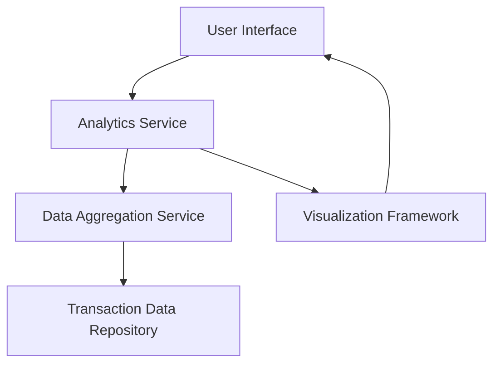

#### 1. High-Level Design

- **Summary:** This epic delivers comprehensive spending analytics through interactive visualizations that help users understand their spending patterns over time. Users can analyze monthly spend trends to identify seasonal patterns or unusual spending behavior across nine predefined spending categories (Food & Dining, Fuel, Shopping, Travel, Entertainment, Utilities, Healthcare, Education, and Miscellaneous). The feature transforms raw transaction data into actionable insights for better budget management.

- **Component Flow:**

- **Integration Points:**
  - **Upstream:** Transaction data repository for historical spending data
  - **Downstream:** Charting library or visualization framework for rendering interactive charts
  - **Internal:** Data aggregation service for calculating category totals and trends

- **Key Assumptions:**
  - Transactions are pre-categorized into the nine predefined categories at the time of ingestion or through a separate categorization service.
  - Historical transaction data is retained for at least 12 months to enable meaningful trend analysis.

- **NFR Highlights:** Visualizations must render within 3 seconds; System must handle minimum 1000 transactions per user; Charts must be interactive and responsive across all device types.

- **Data Flow:** User requests spending analytics through the UI → Analytics Service retrieves user transaction data from Transaction Data Repository → Data Aggregation Service processes and categorizes transactions into nine spending categories and calculates monthly trends → Processed data is passed to Visualization Framework which generates interactive charts → Rendered visualizations are displayed to the user through the UI with drill-down capabilities for detailed analysis.

#### 2. Validation Report

- **Requirements Coverage:** The design fully covers the epic's stated scope including monthly spend trend visualization, category-wise spending analysis across all nine categories, interactive charts and graphs, transaction data aggregation, and spending pattern identification. All NFRs regarding rendering performance (3 seconds), transaction volume handling (1000+ transactions), and responsive design are addressed through the component architecture. The integration with transaction data repository and data aggregation service satisfies the stated dependencies.