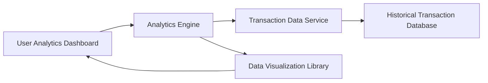

#### 1. High-Level Design

- **Summary:** This epic delivers interactive visualizations and analytics capabilities that enable users to understand spending patterns through category-wise breakdowns across nine predefined categories (Food & Dining, Fuel, Shopping, Travel, Entertainment, Utilities, Healthcare, Education, Miscellaneous). The module provides visual representations of spending data, monthly spend trends, and card-wise analysis to support data-driven financial decisions.

- **Component Flow:**

- **Integration Points:**
  - **Upstream:** Transaction data service (provides transaction data for analysis), Analytics engine (performs data aggregation and trend analysis)
  - **Downstream:** Historical transaction database (stores at least 12 months of transaction history), Data visualization library (renders interactive charts and graphs)

- **Key Assumptions:**
  - Category assignments are pre-defined and consistently applied across all transactions via the transaction management module.
  - Historical data for at least 12 months is available and accessible for trend analysis and monthly spend tracking.

- **NFR Highlights:** Analytics visualizations must render within 3 seconds; support interactive charts with smooth transitions; system must handle historical data analysis for at least 12 months; responsive chart rendering across all device types.

#### 2. Validation Report

- **Requirements Coverage:** The design comprehensively covers all scope elements including category-wise spending analysis, interactive visualizations, monthly spend trends, card-wise spend analysis, spending pattern identification, and multi-category expense tracking across all nine specified categories. All integration dependencies (transaction data service, analytics engine, data visualization library, historical transaction database) are incorporated into the architecture. The NFRs are fully addressed: 3-second render time, interactive charts with smooth transitions, 12-month historical data support, and responsive rendering. The component flow ensures efficient data retrieval, processing, and visualization for actionable spending insights.