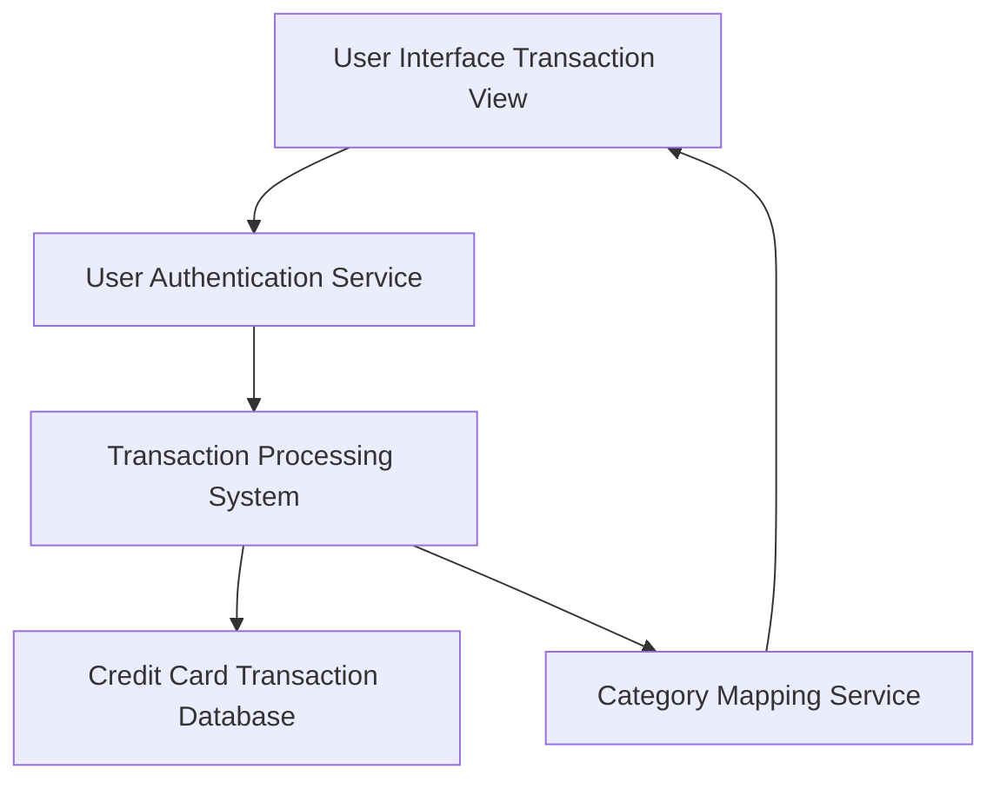

#### 1. High-Level Design

- **Summary:** This epic provides comprehensive transaction management capabilities enabling users to view, track, and monitor all credit card transactions across their portfolio. Users can access detailed transaction histories, view transaction details, and see transactions organized by spending categories, providing complete visibility and transparency into all credit card activity.

- **Component Flow:**

- **Integration Points:**
  - **Upstream:** User authentication service (for secure access control), Transaction processing system (transaction data ingestion and management)
  - **Downstream:** Credit card transaction database (persistent storage of transaction records), Category mapping service (transaction categorization logic)

- **Key Assumptions:**
  - Transactions are stored with sufficient metadata (merchant, amount, date, category) to support filtering and categorization.
  - Pagination is implemented to handle large transaction volumes efficiently, with a default page size optimized for performance.

- **NFR Highlights:** Transaction list must support pagination for large datasets; system must display transactions with sub-second latency; support for displaying at least 1000 transactions per card without performance issues; responsive transaction views across all devices.

#### 2. Validation Report

- **Requirements Coverage:** The design fully addresses the epic's scope including transaction viewing, transaction history access, multi-card transaction consolidation, transaction detail display, transaction categorization support, and transaction listing/filtering. The architecture incorporates all required integration points (transaction processing system, transaction database, category mapping service, authentication service). All NFRs are explicitly supported: pagination for large datasets, sub-second latency, 1000+ transaction capacity per card, and responsive design. The component flow ensures secure, performant access to transaction data with proper categorization support.