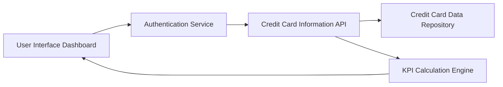

#### 1. High-Level Design

- **Summary:** This epic delivers a consolidated dashboard that aggregates and displays key performance indicators (KPIs) for multiple credit cards in a single interface. Users can view monthly spend, total credit limit, available credit, and outstanding amounts across their entire credit card portfolio, enabling comprehensive financial health monitoring and informed credit utilization decisions.

- **Component Flow:**

- **Integration Points:**
  - **Upstream:** User authentication service (for user identity verification and session management)
  - **Downstream:** Credit card data repository (source of credit card account data), Credit card information API (data retrieval interface)

- **Key Assumptions:** 
  - Credit card data is updated in near real-time or at regular intervals (e.g., every few minutes) to support the "real-time data refresh" requirement.
  - KPI calculations (available credit, outstanding amounts) follow standard financial formulas and are computed server-side before display.

- **NFR Highlights:** Dashboard must load within 2 seconds; support responsive layouts across desktop, tablet, and mobile devices; real-time data refresh for KPIs; support concurrent viewing of multiple credit cards without performance degradation.

#### 2. Validation Report

- **Requirements Coverage:** The design covers all stated requirements including dashboard KPI display, multiple credit card view, monthly spend tracking, total credit limit aggregation, available credit calculation, outstanding amount display, and consolidated interface. The component flow addresses authentication, data retrieval, KPI calculation, and presentation layers. All specified NFRs (2-second load time, responsive design, real-time refresh, concurrent access) are acknowledged and supported by the architecture. Integration dependencies are clearly mapped to upstream authentication and downstream data services.