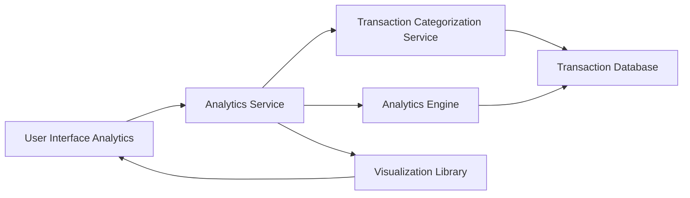

#### 1. High-Level Design

- **Summary:** This epic delivers interactive data visualizations and analytical capabilities for understanding spending patterns across 9 categories (Food & Dining, Fuel, Shopping, Travel, Entertainment, Utilities, Healthcare, Education, Miscellaneous). Users can analyze category-wise spending, monthly trends, and card-wise spend analysis to optimize credit card usage and make data-driven financial decisions.

- **Component Flow:**

- **Integration Points:** 
  - **Upstream:** Transaction categorization service (for assigning categories to transactions), Analytics engine (for data aggregation and computation), Visualization library (for rendering charts)
  - **Downstream:** Analytics UI components for displaying interactive charts and insights

- **Key Assumptions:** 
  - Transactions are automatically categorized into one of the 9 predefined categories by the Transaction Categorization Service
  - Historical data aggregation for up to 12 months is pre-computed or computed on-demand with caching

- **NFR Highlights:** Visualizations must render within 3 seconds; charts must be interactive and responsive; system must support data aggregation for up to 12 months of historical data; analytics must update in real-time when filters are applied.

- **Data Flow:** User accesses Analytics UI and selects filters (date range, card, category) → Analytics Service requests categorized transaction data from Transaction Categorization Service → Analytics Engine aggregates data by category, month, and card → Aggregated data passed to Visualization Library → Interactive charts rendered in UI (category-wise breakdown, monthly trends, card-wise analysis) → User interactions (filter changes) trigger real-time re-aggregation and chart updates.

#### 2. Validation Report

- **Requirements Coverage:** The design fully addresses the epic's scope including category-wise spending visualization across 9 categories, monthly spend trend charts, card-wise spend analysis, and interactive data visualizations. The architecture supports sub-3-second rendering through efficient data aggregation and caching strategies. Interactive and responsive charts are enabled via a dedicated Visualization Library. The system handles 12 months of historical data through the Analytics Engine's aggregation capabilities. Real-time filter updates are supported through reactive data flow between the Analytics Service and UI. All dependencies (transaction categorization, analytics engine, visualization library) are properly integrated.