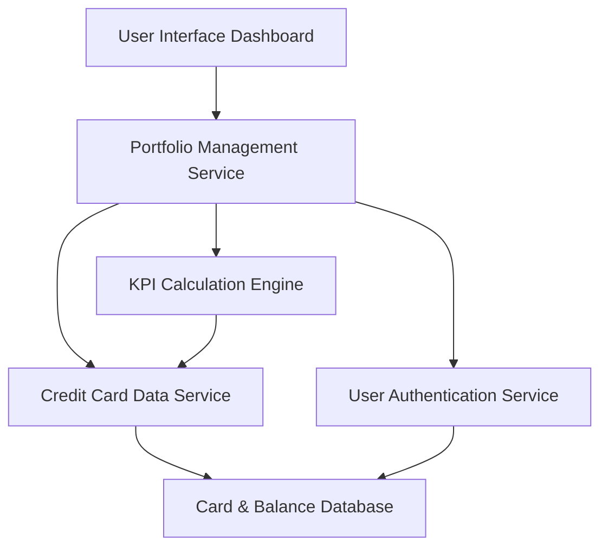

#### 1. High-Level Design

- **Summary:** This epic provides a consolidated dashboard for managing multiple credit cards with real-time KPIs including monthly spending, total credit limits, available credit, and outstanding amounts. Users gain a unified view of their entire credit card portfolio for informed financial decision-making and credit utilization tracking.

- **Component Flow:**

- **Integration Points:** 
  - **Upstream:** Credit card data service (for retrieving card details and balances), User authentication service (for secure access)
  - **Downstream:** Dashboard UI components for KPI visualization and card portfolio display

- **Key Assumptions:** 
  - Credit card data is updated in near real-time by external data feeds or batch processes
  - KPI calculations (monthly spend, available credit, outstanding amounts) are computed on-demand or cached with short TTL

- **NFR Highlights:** Dashboard must load within 2 seconds; real-time data refresh for KPIs; responsive design for desktop and mobile; 100% data accuracy for financial calculations.

- **Data Flow:** User authenticates via User Authentication Service → Portfolio Management Service retrieves user's credit card list from Credit Card Data Service → KPI Calculation Engine aggregates data (monthly spend, total credit limit, available credit, outstanding amounts) → Data rendered on Dashboard UI with card-wise breakdowns → Real-time refresh mechanism updates KPIs as underlying data changes.

#### 2. Validation Report

- **Requirements Coverage:** The design comprehensively addresses the epic's scope including dashboard KPI display, monthly spend calculation, total credit limit aggregation, available credit computation, outstanding amount tracking, and multiple credit card view. The architecture ensures sub-2-second load times through efficient service orchestration and caching strategies. Real-time data refresh is supported via the KPI Calculation Engine. Responsive design and 100% financial calculation accuracy are enforced through dedicated UI components and validated calculation logic. All dependencies (credit card data service, user authentication) are properly integrated.